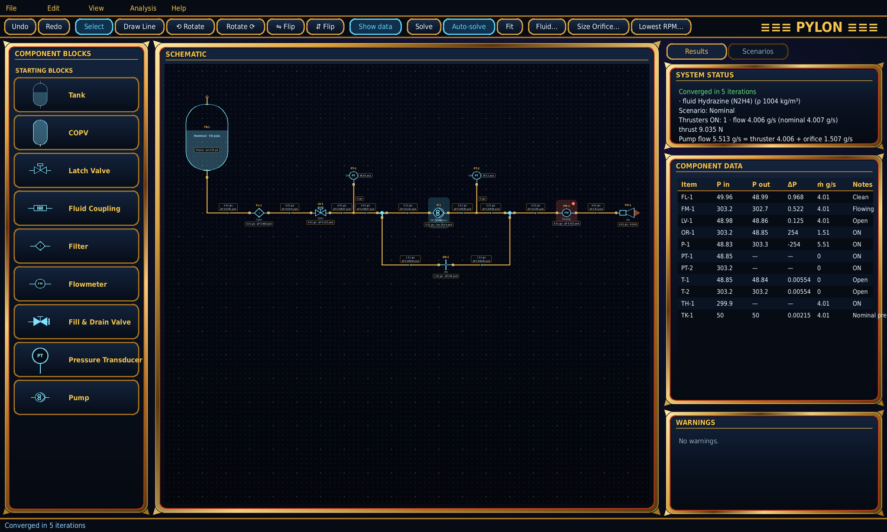

# Pylon

**Pylon** is a desktop tool for drawing a spacecraft liquid-propulsion feed-system schematic and solving it as a steady, incompressible flow network. You build the schematic from drag-and-drop component blocks joined by plumbing lines. Every tube then shows its mass flow and its inlet-to-outlet pressure drop. Pylon also sizes a pump-bypass orifice and finds the lowest pump speed that meets thruster demand, across any number of saved scenarios.



## Features

- **Schematic editor (PySide6).** Starting blocks for a tank, COPV, latch valve, fluid coupling, filter, flowmeter, fill & drain valve, pressure transducer, pump, thruster, orifice, tee, cross and 90° fitting.
  - Click a block's centre to toggle its state, double-click for properties, right-click for its menu.
  - Save customised blocks to a *Component Blocks* library shown in the left column.
  - **COPVs** backfill a tank's ullage at their regulated pressure; **fluid couplings** open (with a flow restriction) or close; **fill & drain valves** are symbolic single-port dead ends.
- **Assemblies.** Save a group of connected parts and their tubes as one named block. Lock it to select and move it as a unit, or unlock it to modify the parts; save it to the library and place copies.
- **Plumbing lines.** Orthogonal tubes that route around every component, never over it.
  - Draw section by section, drag segments and ends, add or delete segments, and combine several lines into one.
  - Lines can tap into other lines.
- **Flow solution.** Node pressures and element flows are solved together by damped Newton–Raphson.
  - Mass flow and ΔP are shown on every tube.
  - Results appear on every component, and pressure transducers read the local pressure.
  - Warnings flag components above their pressure limits.
- **Pump curves.** Import one curve per RPM from a CSV file. An ON pump follows the curve for its set speed (interpolated between stored speeds), so its outlet pressure settles where the pump curve meets the system.
- **Analyses.**
  - **Bypass-orifice sizing:** pump flow = thruster flow + orifice back flow, for one scenario or one diameter for all of them.
  - **Lowest pump RPM** that meets every thruster's nominal flow.
- **Scenarios.** Save and recall sets of toggle states and properties.
- **Quality of life.**
  - Undo/redo.
  - Copy/paste of blocks and groups.
  - Rotate left/right.
  - Show or hide all flow/pressure data: hover to reveal it, or right-click to set it per item.
  - PNG export.

## Physics basis

- Adiabatic, incompressible flow. The working fluid is hydrazine: 1004 kg/m³ and 0.90 mPa·s at 25 °C.
- **Tubing friction:** Darcy–Weisbach with the Churchill (1977) friction factor, valid from laminar through turbulent flow.
- **Fitting losses:** Crane TP-410 resistance coefficients (K = n·f_T) with two-K laminar terms, plus contraction/expansion losses at size changes.
- **Components:** equivalent sharp-edged orifice diameter (ESEOD) with ṁ = Cd·A·√(2ρΔP). Cv is linked by Cv = 29.84·Cd·d². Orifice blocks use Cd = 0.6.
- **Thrusters:** ESEOD into a fixed 0 psia exhaust; thrust F = ṁ·Isp·g₀.

Every equation in the code carries a citation comment; the full reference list is in the [user guide](docs/Pylon.md#8-code-conventions-and-references).

## Getting started

```bash
pip install -r requirements.txt        # PySide6 and numpy
python pylon.py                        # opens the built-in example system
python pylon.py my_system.pylon.json   # open a saved schematic
python pylon.py --selftest             # physics and solver checks, no GUI needed
```

Python 3.9 or newer is required. To try the pump-curve import, right-click a pump → *Pump curves…* → *Import CSV…* and choose `examples/example_pump_curves.csv`.

## Documentation

- [**User guide**](docs/Pylon.md): every feature, the components and their properties, the physics and numerical method, file formats, verification, the original prompt and the living prompt that tracks the program as it changes.
- Project page: <https://andrewjsheckells-cell.github.io/pylon/>

## Repository layout

| Path | Contents |
|---|---|
| `pylon.py` | The whole program (single file) |
| `docs/Pylon.md` | User guide and design reference |
| `docs/index.html` | GitHub Pages project page |
| `docs/images/` | Screenshots |
| `examples/example_pump_curves.csv` | Example pump curves (synthetic gear pump, 2000–6000 rpm) |

## Status

Version 1.16. The solver passes its built-in self-test (`--selftest`), which covers closed-form orifice flow, Hagen–Poiseuille, Colebrook, the Cv relation, mass balances, orifice sizing, pump-curve interpolation and file upgrades. Verify the loss-coefficient defaults against your own hardware data before relying on results for design decisions.
