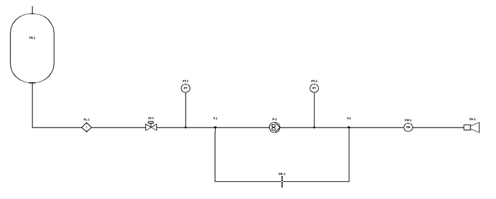

# Pylon

*Formerly "Propulsion Schematic Builder" (renamed in v1.7).*

A PySide6 desktop tool for drawing a spacecraft liquid-propulsion feed-system schematic from drag-and-drop component blocks and plumbing lines, and solving it as a steady, incompressible flow network. Every tube shows its mass flow and inlet-to-outlet pressure drop. The tool sizes a pump-bypass orifice (for one scenario or for all of them at once) and finds the lowest pump RPM that meets the thruster demand.

| | |
|---|---|
| Program | `pylon.py` (single file, version 1.22) |
| Requires | Python ≥ 3.9, `PySide6`, `numpy` |
| Run | `pip install PySide6 numpy` then `python pylon.py [schematic.pylon.json]` |
| Solver self-test (no GUI) | `python pylon.py --selftest` |
| Saved blocks | `Component Blocks/` folder next to the script (created on first save) |
| Start-up | Reopens the most recent schematic (`pylon_settings.json` keeps the recent list); the built-in example if there is none |
| Error log | `Logs/pylon.log` next to the script (or `~/.pylon/Logs/` if that folder can't be written); `python pylon.py --debug` also logs every solve |
| Example data | `examples/example_pump_curves.csv` (synthetic gear-pump curves for the import test) |
| Repository | <https://github.com/andrewjsheckells-cell/pylon> · project page <https://andrewjsheckells-cell.github.io/pylon/> |

---

## 1. Quick start

1. Run the script. An example pump-fed hydrazine system opens: a large tank (outlet tube on its bottom) → filter → latch valve → tee → pump → tee → flowmeter → thruster, with a bypass orifice from the pump-outlet tee back to the pump-inlet tee and two pressure transducers. It has three saved scenarios: *Nominal*, *Maximum tank pressure, clogged filter* and *Minimum tank pressure*.
2. Click the **centre** of any block to toggle its state. The network re-solves immediately; flows and ΔP update over every tube.
3. Add blocks from the **Component Blocks** column on the left (click to add, or drag onto the canvas).
4. Connect them by dragging from a port (small circle) to another port or onto an existing line. The tube is routed automatically around every component.
5. Right-click blocks and lines for their menus; double-click a block for its properties.
6. Use **Analysis → Size bypass orifice…** and **Analysis → Find lowest pump RPM…**.

## 2. User interface

### 2.0 Look and feel
The interface uses a dark sci-fi console style taken from the user's reference screenshot of a game briefing screen.
* **Frames:** every panel sits in a bevelled **gold metallic frame** with rounded corners, angular corner fins and a thin **red inner trim** around a dark navy panel. The panels are the component column, the schematic, System status, Component data, Warnings and Scenarios, plus every dialog.
* **Headings** are engraved gold capitals with a fading gold rule.
* **Buttons** are dark plates with gold borders. Dialog accept buttons (OK, Apply) have **green** text and cancel/close buttons have **red** text, like the reference's Start/Cancel.
* **Components and fittings have no frame or border.** Each is just its glowing cyan symbol on the canvas. **Labels sit close to the symbol, inside the block's invisible box:** the name just above the symbol, then the state caption (or the pump's RPM row) and the results plate just below it. Where an edge has a port, the labels use a free side instead. The transducer reads beside its gauge. **Tees, crosses and 90° fittings have no labels on the canvas** (no name, no results, also when hovering or in a line drawing): their name and flows are in the tooltip, Properties and the Results tab. On a rotated in-line block the name and state go left of the symbol and the results right of it. The tank shows its name, state and results inside the capsule. Wide result text may extend past the box sideways. Blocks in an OFF or blocked state show a grey symbol. A selected block gets a soft translucent cyan halo; a block with a warning gets a translucent red halo and a "!" badge. The click/hit area is still the block's full footprint.
* **Pump symbol:** the gear-pump symbol — a casing circle with two touching gear circles and a **V whose point marks the outlet**, so the V shows the flow direction (left to right on an unrotated block; it turns with the block when rotated). The gears are shaded while the pump is ON and the symbol is grey when it is OFF.
* **Tank:** drawn 4× the earlier size (a 176 × 280 px capsule in a 200 × 400 px footprint), with brass tube stubs from the capsule to the top inlet and the bottom outlet. The fill level shows the state (Nominal / Maximum / Minimum), and the state and pressure are written inside the tank.
* **Plumbing lines** are drawn as brass pipes (dark outline, gold body, light highlight) with cyan flow arrows, and turn cyan when selected.
* **Flow labels** are dark plates with a thin gold border. They are placed beside each tube so they do not cover blocks or other labels where there is room.
* **Background:** the canvas is a deep-space gradient with a faint cyan dot grid and gold cross-hairs every 100 px. The window background is a dark indigo radial glow.
* **Text** is pale cyan-white with muted blue-grey secondary text; warnings are red and success is green.
* **Fonts:** Bahnschrift, falling back to Segoe UI, Helvetica Neue or DejaVu Sans.
* **Implementation:**
  * one `draw_bezel()` painter routine is shared by panels and dialogs (components are drawn without it);
  * an application style sheet covers the standard widgets;
  * the Qt Fusion style keeps the look the same on every OS;
  * all colours live in the `THEME` dictionary at the top of the GUI section, so the look can be retuned in one place.
* **Not copied:** no logos, artwork, fonts or other game assets are included.

### 2.1 Layout
* **Left: Component Blocks column.** Enclosed in a gold bezel frame and scrollable when it is taller than the window. *Starting blocks* (the fourteen built-in types) come first, then *Saved blocks, assemblies & lines* (every `.json` in `Component Blocks/`; a saved assembly shows its parts' symbols and "Assembly · N parts", a saved line its blue shape and "Line · ID · length · bends"). Click an entry to add it near the centre of the view at a free spot, or drag it to a location. Right-click a saved entry to delete it from the library.
* **Centre: schematic canvas.** It has a 20 px dot grid; blocks snap to 10 px. Mouse wheel zooms, middle-drag pans, **F** fits all. Right-click empty canvas for *Add block here*, *Paste here*, *Auto-route all lines* and *Solve now*.
* **Right: Results and Scenarios tabs** (tabs on top; each panel in its own bezel frame).
  * *Results:* a solver status line, total thruster flow vs nominal, thrust, and the pump balance (pump flow = thruster flow + orifice flow). Below that are a table of every block and line section and a list of warnings. Double-click a row or warning to select that item on the canvas.
  * *Scenarios:* save, update, apply, rename, duplicate and delete scenarios.
* **Toolbar:** Undo, Redo │ Select/Move, Draw Line, ⟲ Rotate left, Rotate right ⟳, ⇋ Flip horizontal, ⇵ Flip vertical │ Show flow / pressure data │ Solve, Auto-solve, Fit │ Fluid…, Size Orifice…, Lowest RPM….

### 2.1a Undo, rotate, flip, icon size and data visibility
* **Undo / Redo** (toolbar, Edit menu, **Ctrl+Z** / **Ctrl+Y** or Ctrl+Shift+Z).
  * Every change to the schematic is one undo step: adding, moving, rotating, deleting, pasting or editing blocks and lines, toggling states, editing properties, scenarios, fluid settings, and data-label visibility.
  * Changes made in the same moment (e.g. rotating several selected blocks) are one step.
  * Making a new change after undoing discards the redo steps.
  * Up to 200 steps are kept. The history starts fresh when a file is opened or a new one started.
  * Selection and zoom are not undo steps.
* **Rotate left / right** (toolbar, Edit menu, block right-click menu; **R** = right/clockwise, **Shift+R** = left/counter-clockwise) turns every selected block 90°, ports and symbol included; attached lines re-route.
* **Flip horizontal / vertical** (toolbar, Edit menu, block right-click menu; **H** = horizontal, **V** = vertical) mirrors every selected block left-right or top-bottom on screen, whatever its rotation. The ports move with it (a horizontally flipped valve takes flow in on the right), and attached lines re-route. Lettering inside symbols (FM, PT) stays upright and readable. Flipping twice restores the block; horizontal then vertical equals a 180° rotation.
* **Icon size: Small, Medium or Large** (block right-click menu → *Icon size*, or *Edit → Icon size* for the selection) scales a block's symbol, footprint and tube stubs to 0.75×, 1× or 1.5×. Ports stay on the 10 px grid, and attached lines re-route. The size belongs to the block: it is saved in the schematic, in saved blocks (*Save Block…*), in copies and in assemblies. Placing a saved block uses its saved size, flip and rotation. Parts of a locked assembly can't be flipped or resized until it is unlocked.
* **Show flow / pressure data** (toolbar toggle, View menu, empty-canvas right-click, **D**) shows or hides every flow and pressure label at once: line ṁ / ΔP labels, block result labels and transducer readings. Block names and the pump's flowrate box stay visible.
  * **While the data are hidden, hovering over a block or line shows its labels** (drawn above neighbouring items) until the mouse leaves.
  * **Per element:** right-click a block or line → *Show flow / pressure data here* (checkable) shows or hides that element's labels regardless of the global switch. With several items selected it applies to all of them.
  * Using the global toggle again resets every element to follow it.
  * The global setting and the per-element choices are saved in the schematic file.

### 2.2 Blocks
* **Ports:** blocks take flow in on the left and send it out on the right. A tee's branch is on the bottom, and a 90° fitting's outlet is on the bottom. The **tank** is the exception: its **inlet is on the top** (fill or pressurant connection) and its **outlet is on the bottom**. A **COPV** has a single outlet on the bottom, and a **fill & drain valve** a single connection point on the left (its other side is capped). Rotate 90° and Flip turn or mirror any block, ports included.
* **Move:** drag the body (multi-select with Ctrl-click or a rubber band).
* **Toggle state:** click the centre zone of the block (the cursor becomes a pointing hand). Two-state blocks switch between their two states; the tank cycles Nominal → Maximum → Minimum pressure. **Tees, crosses, 90° fittings and fill & drain valves have no toggle**: fittings are always open, a fill & drain valve is always a dead end; none of them shows a state caption, a State menu or a state field.
* **Right-click menu:** Properties…, State ▸ (pick any state directly), Rotate right 90° / Rotate left 90°, Flip horizontal / Flip vertical, *Icon size* ▸ Small / Medium / Large, *Pump curves…* and *Find lowest RPM…* (pumps), *Size this orifice…* (orifices), *Show flow / pressure data here*, **Copy**, **Duplicate Block**, **Save Block…**, **Delete Block**. (Tees and 90° fittings have no State entry.)
* **Double-click** the body to open Properties. Calculated values appear read-only at the bottom of the dialog.
* **Pump speed on the block:** when a pump is ON, its speed (rpm) appears in an editable box on the block. Click it, type a value and press Enter. The pump's flow then comes from its imported curves at that speed.
* **Save Block** writes the block's type, properties, state, orientation and pump curves to `Component Blocks/<name>.json`. It then appears under *Saved blocks* in the left column.
* **Warnings** (pressure above a component's max, pump outside its inlet/outlet/ΔP limits, thruster inlet above max, negative absolute pressure) turn the block border red, add a "!" badge, and list the reason in the tooltip and the Results tab.
* **Copy and paste (Ctrl+C / Ctrl+V, or Ctrl+P):** select one block or a group (Ctrl-click or rubber band) and press **Ctrl+C**, or right-click → *Copy*.
  * The copy includes every selected line, plus every line whose attached ends all land on copied blocks or copied lines. That means the tubes between the copied blocks, and transducer tap lines, come along automatically.
  * A selected line whose end is attached to something that was not copied is pasted with that end free.
  * **Ctrl+V** (Ctrl+P also works) pastes next to the original. Each further paste of the same copy steps 40 px further. The group is nudged right/down until it clears every existing block and line; if there is no room nearby, it is placed below the whole schematic.
  * Right-click empty canvas → *Paste here* centres the group on the click point.
  * **Copy names:** a pasted or duplicated block takes the original's name with its number increased by 1 (LV-1 → LV-2, TK-09 → TK-10, "Valve 2 left" → "Valve 3 left"). A name without a number gets " 1" added ("Main filter" → "Main filter 1"), and later copies keep counting ("Main filter 2", …). A name already in use is skipped (copying LV-1 when LV-2 exists gives LV-3). Pasted lines take the next free line names (L12, …).
  * Pasted blocks and lines get new identifiers, keep their properties, states, orientation and pump curves, and are selected so they can be dragged as a group.
  * The copy is also put on the system clipboard, so it can be pasted into a second window of the program.
  * While a text field (including the pump's flowrate box on the block) has the keyboard, these keys act on the text instead.
* **Keyboard:** Ctrl+Z undoes and Ctrl+Y (or Ctrl+Shift+Z) redoes; Delete removes the selection; Ctrl+C copies, Ctrl+V / Ctrl+P pastes, Ctrl+D duplicates the selection (blocks plus the lines between them) in one step; R rotates right and Shift+R rotates left; H flips horizontally and V vertically; D shows/hides the flow and pressure data; S selects, L draws lines, Esc cancels or clears.

### 2.2a Assemblies (saved groups of parts)
An **assembly** is a group of connected parts, fittings and the tubes between them that is kept, moved and saved as one block, e.g. a filter + latch valve feed module or a thruster with its flowmeter.
* **Create:** select the parts (Ctrl-click or rubber band), right-click one of them → *Save selection as assembly…* and give it a name. The tubes between the selected parts join the assembly automatically (same rule as Copy). The assembly is created **locked** and is also written to the library (`Component Blocks/<name>.json`), where it appears in the left column.
* **Outline:** every assembly is drawn with a dashed rounded outline around its parts and a tag "name · locked" (gold, padlock closed) or "name · unlocked" (cyan, padlock open). The outline is not an obstacle for lines.
* **Locked** (behaves as one block):
  * clicking any part selects the whole assembly; dragging moves it rigidly, its own tubes carried along unchanged; lines to the outside follow and re-route as usual;
  * rotating a part, or dragging an internal tube's segments or ends, is refused (the status bar says so). Because the whole assembly is selected, Delete removes the whole assembly: the block menu's Delete becomes *Delete assembly*, and an internal tube's menu is reduced to Copy, Properties, data visibility, the Assembly submenu and *Delete assembly*;
  * opening Properties or Pump curves on a part asks *Unlock it to modify its parts?*: Yes unlocks the assembly and opens the dialog;
  * **state toggles still work** (open/close a valve inside a locked module), and external lines can still be connected to its ports.
* **Unlocked:** every part and tube is edited, moved, rotated, re-routed or deleted individually, exactly like loose items; the outline follows the parts.
* **Assembly submenu** (right-click any member): *Unlock* / *Lock*, *Add N selected items to this assembly* (unlocked only), *Remove this item from the assembly* (unlocked only), *Rename…*, *Save to library…* (writes or overwrites the library entry with the assembly as it is now) and *Dissolve (keep the parts)*.
* **From the library:** click or drag a saved assembly to place a fresh copy as a new **locked** assembly with new block names (incremented as for copies) and the name incremented ("Feed module" → "Feed module 1"). All properties, states, orientations, pump curves and internal tubes are restored.
* **Copy/paste and duplicate** of an assembly makes a new assembly (name incremented); copying some loose items together with an assembly keeps the loose ones loose.
* Deleting all of an assembly's members removes the assembly. Assemblies, their names and lock state are saved in the schematic file and are part of undo/redo. They have no effect on the flow solution.

### 2.3 Plumbing lines
* **Auto-routed lines:** drag from a port and release on another port or on a line. The route is an orthogonal A* search [HART] on the 10 px grid that treats every block body (plus 10 px clearance) and every other port as an obstacle, with a penalty for bends. It leaves each port straight out in the port's direction.
* **Drawn lines (Draw Line mode, L):** click to start on a port, a line or empty canvas. Each click adds a horizontal or vertical section, snapped to the dominant direction. Click a port or line to finish attached; right-click or double-click to finish with a free (dead-end) end; Esc cancels. A section that would cross a block or a foreign port is refused and the preview turns red.
* **Lines never pass under or over blocks or ports.** This is enforced everywhere:
  * a segment drag that would cross a block is not applied;
  * when a block moves, auto-routed lines re-route on release;
  * any line that the move made cross a block is re-routed.
* **Drag a segment** to move it perpendicular to itself. Neighbouring segments stretch, and attached ends stay put because a stub is inserted automatically.
* **Drag an end** (cross cursor) to detach it and drop it on a port, a line or empty space.
* **Line-to-line connections:** an end dropped on another line forms a junction (filled dot). Hydraulically, the target line is split at that point. Its length and bend count are divided in proportion to the position along the drawn path.
* **Right-click menu:** Properties…, **Add segment here** (splits the segment at the cursor; drag either half to form the new section), **Delete segment** (slides a neighbour so the segment collapses; refused if it would move an attached end or cross a block), Auto-route, Reverse direction, Delete line.
* **Combine:** select several lines that form one continuous chain (Ctrl-click or rubber band), right-click → *Combine N lines into one…*. A properties dialog opens pre-filled with the first line's sizes, the summed length and the summed bend count. The result is one line with the same properties throughout. Lines tapped onto the old pieces are re-attached to the combined line.
* **Labels:** above each tube (or beside a vertical one) a two-line label shows `ṁ g/s` and `ΔP psid`, with ΔP measured from inlet to outlet in the actual flow direction. Tubes with no flow show `0 g/s`. Each label tries several positions (above/below or right/left, and along the segment) and takes the first that clears every block and every other label. A filled arrow shows the flow direction. Lines with taps show one label per section. The toolbar's *Show flow / pressure data* (D) toggles them all, hovering reveals hidden ones, and right-click → *Show flow / pressure data here* sets them per line (§2.1a).
* **Line properties are independent of the routing.** Right-click a line → *Properties…* to set its tube (outer / inner diameter, roughness), its **length** and its bends. They are flow inputs only: the drawn route, its length on screen and its corners are never used, so the line can still be dragged, reshaped, re-routed, split or extended as usual without changing them.
  * **Bend table:** one row per kind of bend — angle (up to 180°), bend radius / tube diameter, and count — with *Add bend*, *Remove selected* and *From 90° bend count*. When the table has rows it replaces *Number of bends (90°)* and *Bend radius / diameter*; when it is empty those two are used. The tooltip summarises the bends (e.g. "6 bends (4 × 90° r/D 1.5, 2 × 45° r/D 1.5)"). See §4.2 for the losses.
  * **Blue = properties set.** Once a line has been given properties (OK in *Properties…*, a saved line placed or applied, or *Combine*), it is drawn **blue** instead of brass (cyan while selected). Lines in files from before v1.22 are blue when their properties differ from the defaults.
  * **"Are you sure?"** Deleting a blue line (Delete key, *Delete line*, *Delete selected lines*) asks first. Lines with default properties are deleted without asking; undo (Ctrl+Z) works either way.
  * **Names:** a name you give a line in *Properties…* is shown beside its longest segment (gold, like block names), in the line drawing too. Automatic names (L1, L2 …) are not shown. Copies keep the name, numbered if it is already in use.
* **Saved lines:** right-click a line → *Save Line…* writes its name, properties (bend table included) and drawn shape to `Component Blocks/<name>.json`; it appears under *Saved blocks, assemblies & lines*.
  * Click or drag the entry to place a copy with free ends (blue, named), then drag its ends onto ports or lines.
  * Right-click any line(s) → *Apply saved line ▸* gives the selected lines that saved line's properties, keeping their own route and name.
  * Right-click the entry in the column to delete it from the library.

### 2.4 Scenarios
A scenario is a saved snapshot of **every block's toggle state and every editable property, plus every line's properties**. Examples: tank at max pressure with a dirty filter, a different pump flowrate, a valve closed.
* *Save current as new scenario…* stores the canvas as it is now.
* *Apply* (or double-click) restores it.
* *Update selected from current* overwrites it with the canvas.

Blocks added after a scenario was saved keep their current values when it is applied. Pump curves belong to the block, not to the scenario. Scenarios are saved in the schematic file.

### 2.5 Files
* **At start-up Pylon reopens the most recently opened or saved schematic.** If that file has been moved or deleted, it opens the next most recent one that still exists. If the newest file can't be read, or there is no recent file, it opens the built-in example. A file named on the command line (`python pylon.py my_system.pylon.json`) is opened instead.
* *File → Open recent* lists the last 10 schematics opened or saved (hover for the full path), plus *Clear list*. *File → Open…* starts in the folder of the most recent schematic.
* The list is kept in `pylon_settings.json` next to `pylon.py` (or `~/.pylon/settings.json` if that folder can't be written).
* *File → Save / Open* writes or reads a schematic as JSON (`*.pylon.json`; older `*.prop.json` files still open). See §6.
* *File → Export image (PNG)…* renders the whole schematic at 2× resolution, as it looks on screen.
* *File → Export line drawing (black and white)…* (Ctrl+Shift+P) exports a clean black-on-white drawing of the whole schematic for reports and reviews.
  * Symbols and tubes are drawn as thin black lines on white, with junction dots where lines tap into lines.
  * Nothing from the console look is included: no grid, colours, glow, tank fill, thruster plume, port rings, selection, warning badges or assembly outlines.
  * Options: component names (on), component states (Open, Closed, ON · 3000 rpm …), flow and pressure data, and flow-direction arrows (all off by default).
  * The file type follows the extension: **SVG** or **PDF** for scalable vector drawings (the PDF page is sized to the schematic), or **PNG** at 3× (about 300 dpi, capped at 12 000 px).

  
* *File → Open example* reloads the built-in example.

### 2.6 Error log and error reports
* **Log file.** Every session appends to `Logs/pylon.log` next to `pylon.py`; if that folder can't be written, `~/.pylon/Logs/` is used. The file rolls over at 1 MB and the 5 most recent old files are kept (`pylon.log.1` … `pylon.log.5`). Warnings and errors are also printed to the terminal, if Pylon was started from one.
* **What is logged:**
  * session start, with the Pylon, Python, PySide6/Qt and numpy versions and the operating system;
  * files opened and saved, images exported, pump curves imported;
  * **warnings:** every component or solver warning (pressure above a limit, pump outside its curves or limits, thruster inlet above maximum, COPV warnings, …) is logged as `Warning: <name>: <text>` when it first appears, and `Warning cleared: …` (with its latest values) when it goes away. A warning counts as the same warning while only its numbers change (e.g. *SGP-1: Outlet 968 psia above maximum 400* → *533 psia*), so it is not logged again on every solve; with `--debug` the changing values are logged too. A solve that does not converge is logged once, along with when it converges again. Qt warnings and Python warnings are logged too;
  * **errors:** files that can't be opened or written, failed curve imports, solver exceptions, and every unhandled error with its full traceback.
* **Unexpected errors** open an *Error* dialog instead of failing silently. The dialog shows the error and traceback and where it was logged, with *Save error report…*, *Copy details*, *Open log folder* and *Close*. Pylon keeps running; if the schematic looks wrong afterwards, save it under a new name. A hard crash inside Qt is written to `Logs/crash.log`.
* **Help → Generate error report… (Ctrl+Shift+E)** asks what you were doing (optional) and whether to include the schematic, then saves a text file (`pylon_error_report_<date>_<time>.txt`, in the log folder by default). Its sections are:
  * the description;
  * the environment, including the schematic file name and whether it has unsaved changes;
  * every error recorded this session, with tracebacks;
  * the solver status with **every current warning**, by component name;
  * the last 1000 log entries;
  * optionally, the schematic as JSON (save that part as `.pylon.json` to reopen it).
* **Help → Open log folder** opens the log folder in the file browser.
* **`python pylon.py --debug`** also logs every solve.

## 3. Components

Property names in the table are the labels shown in the Properties dialog; the `code key` after each one is the name used in the program and in saved files.

| Block | Ports | Toggle states (click centre) | Editable properties | Calculated properties |
|---|---|---|---|---|
| Tank | inlet (top), outlet (bottom) | Nominal pressure / Maximum pressure / Minimum pressure | Volume [L] `volume`; Maximum pressure [psia] `maximum_pressure`; Nominal pressure [psia] `nominal_pressure`; Minimum pressure [psia] `minimum_pressure`; Inlet tubing size (top) `inlet_tubing_size`; Outlet tubing size (bottom) `outlet_tubing_size` | Tank pressure (current state) [psia] `calculated_pressure`; Inflow through the top inlet [g/s] `calculated_inflow`; Net outflow [g/s] `calculated_net_outflow`; Time to empty at the current net outflow [s] `calculated_time_to_empty` |
| COPV (`copv`) | outlet (bottom) | Backfilling / Isolated | Volume [L] `volume`; Bottle pressure [psia] `bottle_pressure`; Maximum pressure (MEOP) [psia] `maximum_pressure`; Ullage pressure setpoint (regulated) [psia] `ullage_pressure_setpoint` (0 = unregulated, full bottle pressure); Outlet tubing size `outlet_tubing_size` | Ullage pressure delivered [psia] `calculated_delivered_pressure`; Tanks backfilled `calculated_tanks_backfilled`; Ullage backfill volume flow [mL/min] `calculated_backfill_volume_flow` |
| Latch Valve | inlet, outlet | Open / Closed | Equivalent orifice diameter, open state [in] `open_orifice_diameter`; Equivalent orifice diameter, closed state (leak) [in] `closed_orifice_diameter`; Discharge coefficient `discharge_coefficient`; Flow coefficient Cv (open) [gpm/√psi] `flow_coefficient`; Inlet tubing size `inlet_tubing_size`; Outlet tubing diameter `outlet_tubing_size`; Maximum pressure [psia] `maximum_pressure` | Inlet pressure; Outlet pressure; Pressure drop; Mass flow (`calculated_inlet_pressure`, `calculated_outlet_pressure`, `calculated_pressure_drop`, `calculated_mass_flow`) |
| Fluid Coupling (`fluid_coupling`) | inlet, outlet | Open / Closed | Equivalent orifice diameter (open, flow restriction) [in] `orifice_diameter`; Discharge coefficient `discharge_coefficient`; Flow coefficient Cv (open) `flow_coefficient`; Inlet tubing size; Outlet tubing size; Maximum pressure [psia] `maximum_pressure` | Inlet pressure; Outlet pressure; Pressure drop; Mass flow |
| Filter | inlet, outlet | Clean / Maximum trapped particles | Equivalent orifice diameter, no trapped particles [in] `clean_orifice_diameter`; Equivalent orifice diameter, maximum trapped particles [in] `clogged_orifice_diameter`; Discharge coefficient `discharge_coefficient`; Flow coefficient Cv (clean) `clean_flow_coefficient`; Flow coefficient Cv (maximum trapped) `clogged_flow_coefficient`; Maximum pressure [psia] `maximum_pressure`; Inlet tubing size; Outlet tubing size | Inlet pressure; Outlet pressure; Pressure drop; Mass flow |
| Flowmeter | inlet, outlet | Flowing / Blocked | Equivalent orifice diameter [in] `orifice_diameter`; Flow coefficient Cv `flow_coefficient`; Discharge coefficient `discharge_coefficient`; Maximum pressure [psia] `maximum_pressure`; Inlet tubing size; Outlet tubing size | Inlet pressure; Outlet pressure; Pressure drop; Measured mass flow |
| Fill & Drain Valve (`fill_drain_valve`) | one connection (`inlet`, left) | — (no toggle; always a closed dead end) | Tubing size `inlet_tubing_size`; Maximum pressure [psia] `maximum_pressure` | Pressure at the valve [psia] `calculated_pressure` |
| Pressure Transducer | inlet (bottom) | ON / OFF | Inlet tubing size `inlet_tubing_size` | Pressure reading [psia] `calculated_pressure` (shown under the block) |
| Pump | inlet, outlet | ON / OFF | Speed [rpm] `revolutions_per_minute` (also editable on the block); Inlet tubing size; Outlet tubing size; Equivalent orifice diameter (stopped) [in] `stopped_orifice_diameter`; Discharge coefficient (stopped) `stopped_discharge_coefficient`; Flow coefficient Cv (stopped) `stopped_flow_coefficient`; Maximum inlet pressure `maximum_inlet_pressure`; Minimum inlet pressure `minimum_inlet_pressure`; Maximum outlet pressure [psia] `maximum_outlet_pressure`; Maximum differential pressure [psid] `maximum_differential_pressure`; imported RPM curves `pump_curves` | Inlet pressure; Outlet pressure; Pressure rise `calculated_pressure_rise`; Mass flow [g/s]; Volumetric flow [mL/min] `calculated_volumetric_flow` |
| Thruster | inlet | ON / OFF | Specific impulse [s] `specific_impulse`; Nominal inlet pressure [psia] `nominal_inlet_pressure`; Maximum inlet pressure [psia] `maximum_inlet_pressure`; Equivalent orifice diameter [in] `orifice_diameter`; Discharge coefficient; Flow coefficient Cv; Inlet tubing size | Outlet pressure (hard-coded 0 psia); Inlet pressure; Flowrate [g/s]; Thrust [N] `calculated_thrust`; Flowrate and thrust at nominal inlet pressure `calculated_nominal_mass_flow`, `calculated_nominal_thrust` |
| Orifice | inlet, outlet | ON / OFF (plugged) | Orifice diameter [in] `orifice_diameter`; Inlet tubing size; Outlet tubing size | Discharge coefficient (fixed, 0.6); Cv; Inlet/outlet pressure; Pressure drop; Mass flow (inlet→outlet) |
| Tee | inlet, outlet, branch | — (no toggle; always open) | Inlet tube size `inlet_tubing_size`; Outlet tube size `outlet_tubing_size`; Tee (branch) tube size `branch_tubing_size` | Centre pressure `calculated_center_pressure`; Flow at each port `calculated_inlet_flow`, `calculated_outlet_flow`, `calculated_branch_flow` |
| Cross | inlet, outlet, upper branch (top), lower branch (bottom) | — (no toggle; always open) | Inlet tube size `inlet_tubing_size`; Outlet tube size `outlet_tubing_size`; Upper branch tube size `upper_branch_tubing_size`; Lower branch tube size `lower_branch_tubing_size` | Centre pressure `calculated_center_pressure`; Flow at each port `calculated_inlet_flow`, `calculated_outlet_flow`, `calculated_upper_branch_flow`, `calculated_lower_branch_flow` |
| 90° Fitting (`elbow`) | inlet, outlet (bottom) | — (no toggle; always open) | Inlet tube size; Outlet tube size | Inlet/outlet pressure; Pressure drop; Mass flow |
| Plumbing line | start, end (port, another line, or free) | — | Outer diameter [in] `outer_diameter`; Inner diameter [in] `inner_diameter`; Length [in] `length`; Number of 90° bends `bend_count`; Bend radius / diameter `bend_radius_ratio`; Bend table `bend_table` (rows of angle °, r/D, count; replaces the two above when not empty); Absolute roughness [in] `roughness` | Mass flow (start→end) `calculated_mass_flow`; Pressure drop inlet→outlet `calculated_pressure_drop`; Velocity `calculated_velocity`; Reynolds number `calculated_reynolds_number` |

Notes
* **ESEOD (equivalent sharp-edged orifice diameter) / Cv / Cd are linked.** Editing the diameter or Cd recalculates Cv, and editing Cv recalculates the diameter (with Cd held), using `Cv = 29.84 · Cd · d²` (d in inches, water at 60 °F) [ISA].
* **Latch valve closed:** no flow when the closed-state ESEOD is 0, otherwise a leak orifice. **Flowmeter blocked**, **orifice OFF** and **thruster OFF** carry no flow. Tees and 90° fittings are always open; a tee or fitting saved as OFF by an earlier version opens as open. **Transducer OFF** hides its reading.
* **COPV:** connect its outlet to a tank's **top inlet** through lines and open components. While *Backfilling* it holds that tank's ullage at the setpoint (or at the bottle pressure if the setpoint is 0 or above the bottle pressure), and the tank's *Nominal / Maximum / Minimum* state pressure is overridden. The tank shows "COPV backfill · X psia" and its result label reads "X psia (COPV)". *Isolated* returns the tank to its own state pressure. Pressurant passes through tees, crosses, 90° fittings and filters, and through latch valves, fluid couplings, flowmeters and orifices only when they are open; a closed one (or a pump, thruster, transducer or fill & drain valve) blocks it. With two COPVs on one tank the higher pressure wins. The pressurant lines carry no liquid, so they show 0 g/s.
* **Fluid coupling:** *Open* = mated coupling with its flow restriction as an equivalent orifice; *Closed* = demated / capped, no flow.
* **Fill & drain valve:** symbolic only. It has **one connection point**, drawn as a closed hand valve with a cap on its service side. It is a dead end (no flow) and reads the pressure where it is connected, like a transducer. A line attached to the outlet of a v1.15 fill & drain valve is left with a free end when the file is opened.
* **Pump OFF** acts as an orifice with the stopped-state ESEOD and Cd.
* **Pump ON always follows its imported RPM curves** (since v1.9; the earlier fixed-flowrate mode was removed because it forced the set flow through whatever pressure that took, which drove the outlet pressure far too high whenever the downstream restriction did not match). The flow comes from the curve for the set speed as a function of the pump ΔP, so the outlet pressure settles where the pump curve meets the system. The flowrate is a calculated result, shown on the block's result plate and in Properties.
* **Pump ON past the end of its curve data** — a pressure rise above the highest (or below the lowest) ΔP point of the curve(s) in use — is flagged with a warning: *ΔP X psid is outside the 3000 rpm curve data (0–300 psid); flow is extrapolated*. Beyond the data the curve is a straight-line extension of its last segment; a stiff positive-displacement curve extended this way can drive the outlet pressure far above anything the pump was tested at. Between two stored speeds only the ΔP range both curves cover counts as data. A running pump with reversed (negative) flow is also flagged.
* **Pump ON with no curves** is solved as stopped (the stopped-state orifice) and flagged with a warning badge: import curves with right-click → *Pump curves…*.
* **Tubing size** fields accept a standard size from the list (OD × wall, inches) or a custom `OD x wall` string such as `5/16" x 0.035"`.
* **Footprints (Medium icon size):** in-line components are 80 px between ports (orifice 60, thruster 50 from the inlet to the centre), so the tube stubs from a symbol to its ports are about 20 px. Tee, cross and 90° fitting arms are 20 px (40 × 40 fittings). The tank's top and bottom stubs are 30 px (200 × 340 footprint), the COPV's 5 px, and the transducer's 21 px. Since v1.18 these are half their earlier lengths; lines in older files that no longer meet their ports are re-routed when the file is opened.
* **Tee orientation:** run = inlet ↔ outlet, branch = bottom port. **Cross:** run = inlet ↔ outlet, branches = top and bottom ports. Fittings show no name or result labels on the canvas; hover for the tooltip. **90° fitting:** inlet on the left, outlet on the bottom (rotate as needed).

## 4. Physics and numerical method

All modelling choices follow the project instructions: adiabatic, incompressible flow; Crane K factors for components; Churchill friction factor for tubing; K factors valid across laminar and turbulent flow; ESEOD-based thrusters; Cd = 0.6 for orifices.

### 4.1 Fluid
**The working fluid is hydrazine (N₂H₄).** It is the default for every new schematic and the built-in example. The fluid is treated as a constant-density, constant-viscosity liquid.

| Fluid | ρ [kg/m³] | μ [mPa·s] | Source |
|---|---|---|---|
| **Hydrazine (default)** | **1004** | **0.90** | Anhydrous hydrazine at 25 °C: 1.004 g/mL, 0.90 cP [HYDRAZINE] |
| MMH | 875 | 0.86 | approximate, ~20 °C |
| NTO (MON-3) | 1440 | 0.42 | approximate, ~20 °C |
| Water | 998.2 | 1.002 | [WHITE], 20 °C |
| IPA | 786 | 2.40 | approximate, ~20 °C |
| HFE-7100 | 1510 | 0.58 | approximate, ~20 °C |

The other presets are kept only for ground-test fluids and comparisons (Analysis → *Fluid and loss coefficients…*). For hydrazine at another temperature, enter its density and viscosity there. Schematic files store their fluid, so a file saved before v1.5 keeps the viscosity it was saved with (0.97 mPa·s); pick the hydrazine preset again to update it.

### 4.2 Tubing (plumbing lines)
For a tube of inner diameter D, length L, area A, mass flow ṁ, velocity V = ṁ/(ρA) and Re = ρVD/μ:

* **Friction:** Δp_f = f·(L/D)·ρV²/2 (Darcy–Weisbach [CRANE], [WHITE]), with the Darcy factor f from **Churchill (1977)** [CHURCHILL]:
  `f = 8·[(8/Re)¹² + (A+B)^-1.5]^(1/12)`, `A = [−2.457·ln((7/Re)^0.9 + 0.27·ε/D)]¹⁶`, `B = (37530/Re)¹⁶`.
  It is continuous from laminar (f = 64/Re) through transition to fully rough turbulent flow. The solver evaluates `Δp_f = (f·Re)·μ·V·L/(2D²)`, which is smooth through zero flow.
* **Bends:** each 90° bend adds K = K∞ + K₁/Re with:
  * K∞ = n(r/D)·f_T, the Crane TP-410 bend table [CRANE] (r/D = 1 → 20 f_T, 1.5 → 14, 2–3 → 12, 4 → 14, 6 → 17, 8 → 24, 10 → 30, …);
  * K₁ = 800 per bend (laminar term, two-K method [HOOPER]).
* **Bends of other angles (bend table):** a bend of angle θ adds K = C∞(θ)·n(r/D)·f_T + C₁(θ)·K₁/Re, with the angle factors taken from the two-K coefficients of 45°, 90° and 180° elbows [HOOPER] (K₁ = 500 / 800 / 1000; K∞ = 0.20 / 0.40 / 0.60), linear in angle between them and zero at 0°:

  | θ | 0° | 45° | 90° | 180° |
  |---|---|---|---|---|
  | C∞ (turbulent) | 0 | 0.5 | 1 | 1.5 |
  | C₁ (laminar) | 0 | 0.625 | 1 | 1.25 |

  Turns over 180° are entered as several rows (e.g. 270° = 180° + 90°). Verify these factors against the Blevins bend-angle data for your geometry. A tapped line shares its length and every bend-table row between its sections pro rata.
* **f_T** is the fully turbulent friction factor of that tube, from Churchill at Re → ∞ on the Crane commercial-steel roughness basis (0.0018 in, editable).
* **Port size mismatch:** where a tube meets a component port whose tubing ID differs by more than 2 %, the line gets a direction-aware loss:
  * contraction K = 0.5(1 − β²) on the small-area velocity [CRANE];
  * Borda–Carnot expansion K = (1 − β²)² on the small-area velocity [CRANE], [WHITE].

### 4.3 Components
| Component | Model |
|---|---|
| Valve, fluid coupling, filter, flowmeter, stopped pump, thruster | Equivalent sharp-edged orifice: `ṁ = Cd·A·√(2ρΔp)`, A = π·ESEOD²/4 [SUTTON], [CRANE] |
| Orifice block | Same, with Cd = 0.6 (setting) |
| Thruster | Orifice from the inlet node to a fixed 0 psia boundary. Thrust F = ṁ·Isp·g₀ [SUTTON], g₀ = 9.80665 m/s² [NIST811]. Nominal flow = flow at the nominal inlet pressure. |
| Tank | **Blowdown pressure source.** The tank is a fixed-pressure boundary at the pressure of the selected state (nominal / max / min, i.e. points on the blowdown curve), and that pressure is what pushes propellant from the tank to the pump inlet. The pump then sets the flow to everything downstream; with the pump OFF it is an orifice and tank pressure alone drives the flow through it. Bottom outlet: entrance loss K = 0.5 for outflow, exit K = 1.0 for back-flow, on the outlet-tube area. Top inlet: exit K = 1.0 for flow into the tank, entrance K = 0.5 for reverse flow, on the inlet-tube area. An unconnected top inlet carries no flow. **With a backfilling COPV on the top inlet** the boundary pressure is the COPV's delivered ullage pressure instead of the state pressure. |
| Tee | Three arms meeting at a centre node. Crane through-run 20 f_T and through-branch 60 f_T are split so in + out = 20 f_T and in + branch = 60 f_T. Laminar K₁: run 200, branch 500. |
| Cross | Four arms meeting at a centre node. Crane TP-410 gives no separate cross coefficient, so the cross uses the tee values: inlet and outlet arms 10 f_T each (run = 20 f_T), each branch arm 50 f_T (inlet + branch = 60 f_T); laminar K₁ likewise (run 200, branch 500). The tee settings in *Fluid and loss coefficients…* apply to crosses too. |
| 90° fitting | Crane standard elbow K∞ = 30 f_T, laminar K₁ = 800, plus area change if inlet and outlet sizes differ |
| Pressure transducer | Dead-end pressure tap: reads the node pressure where it is connected |
| COPV | **Ullage pressure source, not a flow element.** An ideal regulator (regulated pressure feed [SUTTON]) holds the connected tank's ullage at p = min(setpoint, bottle pressure), or the bottle pressure when the setpoint is 0. The connection is found by a separate union-find over lines and components that pass gas (see Notes in §3). Because the liquid is incompressible, the gas volume flow into the ullage equals the liquid volume flow leaving the tank: Q_gas = (ṁ_out − ṁ_in)/ρ, reported in mL/min. Bottle blow-down is not modelled (steady state). |
| Fluid coupling | Open: equivalent sharp-edged orifice with its own ESEOD and Cd (the coupling's flow restriction). Closed: no flow. |
| Fill & drain valve | No element. Its single port is a dead-end node: no flow passes, and it reads the node pressure there. |
| Pump ON | ṁ = ρ·Q(Δp_pump, N), with N the set speed: the operating point is where the pump curve meets the system curve; inlet pressure = tank pressure − upstream losses. At a stored RPM the curve is piecewise linear in Δp with linear extrapolation. **Between two stored RPMs** N_low < N < N_high it interpolates linearly in speed at the same Δp: Q = (1 − w)·Q_low(Δp) + w·Q_high(Δp), w = (N − N_low)/(N_high − N_low) (exact for a positive-displacement pump, Q = displacement·N − slip(Δp)). **Outside the stored range** it uses the nearest end curve and lists a warning. |

**How ESEOD is used.** The equivalent sharp-edged orifice diameter (ESEOD) is an **input**, not something the solver derives from upstream conditions. It is the diameter of the sharp-edged orifice that would pass the same flow as the component at the same pressure drop.
* You enter it directly, or enter Cv and the program back-calculates it with Cd held: `d = √(Cv / (29.84·Cd))` (d in inches) [ISA]. Editing the diameter or Cd recalculates Cv with `Cv = 29.84·Cd·d²`.
* In the network it becomes the flow area `A = π·d²/4` in the orifice law `ṁ = Cd·A·√(2ρΔp)`, rearranged to `Δp = ṁ|ṁ| / (2ρ·Cd²·A²)` [SUTTON], [CRANE]. ρ is the working-fluid density.
* The 29.84 constant is the US-unit form of that same law for water at 60 °F (Cv in gpm at 1 psi). Using it only for the Cv ↔ d conversion and the true density in the flow law keeps the two consistent for any liquid.
* State-dependent diameters are separate inputs: valve open/closed (leak), filter clean/maximum trapped, and pump stopped.
* Tubes, tees, crosses and 90° fittings have no ESEOD; they use Churchill friction and Crane/two-K loss coefficients (§4.2 and the table above).
* The *Size bypass orifice* analysis (§4.5) is the one place a diameter is solved for: it finds the orifice diameter that balances pump flow against thruster demand.

**About the loss-coefficient defaults.**
* The project calls for Crane K factors with Re-dependent values from Blevins' *Applied Fluid Dynamics Handbook*. The two-K form K = K₁/Re + K∞ provides that low-Re behaviour.
* The K∞ values are the Crane TP-410 multiples of f_T.
* The K₁ defaults are the commonly published two-K (Hooper) laminar coefficients.
* **Verify every default against the Blevins tables for your exact geometry.** All of them can be edited in *Analysis → Fluid and loss coefficients…* and are saved with the schematic.

### 4.4 Network solution
* **Network construction:**
  * Ports, line ends and line taps are merged into nodes with a union-find [TARJAN].
  * Each line becomes one or more pipe elements (split at taps).
  * Each block becomes one or more elements between its port nodes.
  * Tanks and the thruster exhaust are fixed-pressure boundary nodes.
* **Unknowns and equations:**
  * Unknowns: the pressure of every free node and the mass flow of every element.
  * Equations: mass conservation at every free node, plus one element law per element. The element law is p₁ − p₂ = Δp(ṁ), ṁ = 0, ṁ = ṁ_set, or ṁ = curve(p₂ − p₁).
* **Robustness:**
  * Quadratic terms use ṁ·√(ṁ² + ε²) with ε = 10⁻⁷ kg/s, so the Jacobian is never singular at zero flow.
  * A linearised pre-solve gives the starting point.
  * Damped Newton–Raphson with backtracking [DENNIS], solving node pressures and element flows together [TODINI], converges to a scaled residual below 10⁻¹⁰, typically in 3–8 iterations.
  * The previous solution is used as a warm start.
* **Ill-posed parts of the network:**
  * Regions with no path to any pressure boundary get no pressure and zero flow.
  * Negative absolute pressures are flagged as an unmeetable flow demand (cavitation).

**Example check (built-in example, nominal scenario).**
* *Pump ON at 3000 rpm (bypass orifice 0.00914 in):* the tank supplies 4.006 g/s. The pump curve settles at 5.513 g/s, taking the flow from 48.8 psia to 303.3 psia. 1.507 g/s recirculates through the bypass orifice and the thruster receives 4.006 g/s at 299.9 psia (nominal 4.007 g/s at 300 psia). The outlet pressure is set by the thruster: the example thruster needs 300 psia at its inlet for its nominal flow.
* *Pump OFF:* tank pressure alone drives 1.495 g/s. 1.237 g/s goes through the stopped pump (as an orifice) and 0.258 g/s goes forward through the bypass orifice; the thruster gets 1.495 g/s at 41.8 psia.

**Math audit (v1.6).** Every equation and constant was recomputed independently of the program, outside its code: unit constants, the Cv constant 29.84, Churchill against Hagen–Poiseuille and Colebrook, f_T, the Crane bend table, two-K fittings, contraction/expansion, the orifice law, thrust, volumetric flow, time to empty, and the CSV unit conversions. Every element of the solved example was then rebuilt from the solved flows (all lines, all orifice-type blocks, the tank exit and the thruster), agreeing to within 0.01 % with mass balance closed to 10⁻¹⁹ kg/s. Seven hand-checkable networks were also solved: series orifices, a parallel split, two tanks, a long turbulent tube, a size contraction, an elbow, and a pump between curves. One error was found and fixed: in *Pump curve @ RPM* mode, a speed between two stored curves silently used the **nearest** stored curve instead of interpolating. At 3500 rpm with curves at 3000/4000 rpm, that under-predicted the pump flow by ~16 % in the test network.

### 4.5 Bypass orifice sizing (Analysis → Size bypass orifice…)
For an orifice in parallel with the pump (one side on the pump-outlet manifold, the other on the tank-outlet / pump-inlet manifold) the target is

`pump flow = thruster flow + orifice back flow`, with every ON thruster at its nominal flow.

* **Ideal d per scenario:** regula falsi (Illinois [DOWELL]) on log d over 10⁻⁴–0.5 in, solving the full network at each step, until Σṁ_thruster = Σṁ_nominal. If the demand cannot be met even with the orifice almost closed, or is still exceeded at 0.5 in, the result says so.
* **One diameter for all scenarios:** each selected scenario (and/or the current canvas state) is evaluated on a 61-point log grid, followed by golden-section refinement [KIEFER]. The ranking is:
  1. fewest scenarios with limit warnings;
  2. the smallest worst-case |thruster flow / nominal − 1|.

  The dialog reports the recommended diameter, the window of diameters that keeps **every** scenario within the tolerance with no warnings (edges refined by bisection), and a per-scenario table. That table lists each scenario's own ideal d, thruster flow vs demand, pump flow, orifice back flow, pump ΔP, pump outlet pressure and any warnings. *Apply* writes the diameter to the orifice and to every saved scenario.

### 4.6 Pump curves and lowest RPM (Analysis → Find lowest pump RPM…)
* **Import:** right-click a pump → *Pump curves…* → *Import CSV…*. One curve is stored per RPM, saved in the block (and in saved blocks). Curves can also be added or edited by hand. The plot shows ΔP vs flow for all RPMs, shaded light-to-dark blue by RPM, with point tooltips.
* **CSV format:** a header row and one row per point. The `rpm` column is optional (you are asked for the RPM if it is missing).
  * Pressure column: `dp_psid`, `dp_psi`, `dp_bar` or `dp_kpa`.
  * Flow column: `flow_ml_min`, `flow_l_min`/`flow_lpm`, `flow_gpm` or `flow_g_s` (mass, converted with the current density).
  * Several RPMs can share one file. *Save CSV template…* writes an example.
* **Search:** for each chosen scenario the pump is set ON at every curve RPM, in ascending order, and the network is solved.
  * The lowest RPM at which every ON thruster gets at least (1 − tolerance) × its nominal flow is reported.
  * The lowest such RPM with no pressure-limit warnings is reported separately.
  * The full table (pump flow, thruster flow, demand, min ratio, pump ΔP, warnings) is shown.

## 5. Verification
`python pylon.py --selftest` runs without a display and checks:
* ESEO thruster flow against the closed form;
* a laminar tube against Hagen–Poiseuille (exact);
* a turbulent tube against Colebrook (within 3 %);
* the Cv relation;
* example-network mass balances (pump = thruster + orifice; tee balance);
* that the ideal-orifice search hits the nominal thruster flow;
* that the A* route clears an obstacle;
* that a version 2 file is upgraded to version 3 with every key renamed;
* that a cross with identical loads on its outlet and both branches balances and splits the branch flows equally;
* that a backfilling COPV sets the tank ullage to its setpoint, an isolated COPV leaves the tank at its own pressure, and a closed coupling between them blocks the backfill;
* that an open fluid coupling in series with a thruster passes the series equivalent-orifice flow;
* that a fill & drain valve on a tank outlet passes no flow and reads the tank pressure, and that a line attached to a v1.15 fill & drain valve outlet is freed on load;
* that copy names increment the last number (with zero padding), add " 1" when there is none, and skip names in use;
* that every port of every block type sits on the 10 px grid and on its box edge at all three icon sizes (latch valve outlet 30 / 40 / 60 px; tee arm 20 px);
* that flips mirror the ports across the screen axes at every rotation, undo themselves, and that horizontal then vertical equals a 180° rotation;
* that a bend table of 3 × 90° gives exactly the same loss as a bend count of 3, and that 2 × 45° + 1 × 180° gives the two-K angle-factor sum (≈ 2.5 × one 90° bend);
* that a pump driven past the end of its curve data is flagged as extrapolated, and that a warning whose numbers change counts as one warning in the log;
* that an error report contains every section, the warnings by component name, and a schematic that reloads exactly;
* that a pump at a speed between two stored curves interpolates correctly (3500 rpm between 3000 and 4000 rpm gear-pump curves gives 396 mL/min at 200 psid), and that a speed outside the stored curves is reported.

## 6. File formats
**Schematic (`*.pylon.json`, version 3)**
```json
{"format": "pylon_schematic", "version": 3,
 "fluid": {"name": "Hydrazine (N2H4)", "density": 1004.0, "viscosity_millipascal_seconds": 0.90},
 "settings": {"orifice_discharge_coefficient": 0.6, "crane_reference_roughness": 0.0018,
              "tank_entrance_loss_coefficient": 0.5, "tank_exit_loss_coefficient": 1.0,
              "elbow_friction_multiplier": 30.0, "elbow_laminar_coefficient": 800.0,
              "tee_run_friction_multiplier": 20.0, "tee_branch_friction_multiplier": 60.0,
              "tee_run_laminar_coefficient": 200.0, "tee_branch_laminar_coefficient": 500.0,
              "bend_laminar_coefficient": 800.0, "size_mismatch_tolerance": 0.02,
              "acceptance_tolerance_percent": 2.0},
 "blocks": [{"identifier": "p1", "type": "pump", "name": "P-1", "x": 1100, "y": 300, "orientation": 0,
             "mirrored": false, "icon_size": "medium", "state": 0, "properties": {"revolutions_per_minute": 3000.0, "...": "..."},
             "pump_curves": {"3000": [[0, 360.0], [100, 348.0]]}}],
 "lines": [{"identifier": "l10", "name": "L10", "points": [[740, 190], [740, 300]], "auto_routed": true,
            "start": {"kind": "port", "block": "pt1", "port": "inlet"},
            "end": {"kind": "line", "line": "l3", "path_fraction": 0.5},
            "properties": {"outer_diameter": 0.25, "inner_diameter": 0.18, "length": 3.0, "bend_count": 1,
                           "bend_radius_ratio": 3.0, "roughness": 6e-05,
                           "bend_table": [[90, 1.5, 4], [45, 1.5, 2]]},
            "properties_defined": true, "name_given": false}],
 "scenarios": [{"name": "Nominal", "blocks": {"<identifier>": {"state": 0, "properties": {}}},
                "lines": {"<identifier>": {"properties": {}}}}],
 "active_scenario": "Nominal",
 "assemblies": [{"identifier": "a7f3c2", "name": "Feed module", "locked": true}],
 "view": {"show_data_labels": true}}
```
* Ports are named `inlet`, `outlet` and `branch`.
* `path_fraction` is the fractional position along the target line's drawn path.
* Line `points` are in scene pixels and are not used by the flow calculation.
* Files from v1.8 and earlier may contain the pump keys `operating_model` and `flow_rate`; they are dropped on load (the pump then follows its curves).
* A block or line that belongs to an assembly carries `"assembly": "<assembly identifier>"`; `assemblies` lists each assembly's name and lock state. Both are absent in files without assemblies.
* `view.show_data_labels` is the global data-label switch. A block or line may carry `"data_label_visibility": true/false` when it has its own override; the key is absent when it follows the global switch.
* **Older files open automatically.** Version 1 and 2 files (format `propschematic`, abbreviated keys such as `props`, `rho`, `p_max`, `eseod`, `od`, ports `in`/`out`, attachment `t`) are converted to version 3 on load by `upgrade_model()`, and are written back as version 3 when saved.
* When a file is opened and a line's end no longer sits on its port (e.g. a version 1 file whose tank outlet was on the right side), that line is re-routed automatically to the port's current position.

* `mirrored` (flipped left-right in the block's own frame, applied before `orientation`) and `icon_size` (`small` / `medium` / `large`) are optional; files without them load as unmirrored, medium.

**Saved block (`Component Blocks/<name>.json`):** `{"format": "pylon_block", "version": 3, "name", "type", "state", "orientation", "mirrored", "icon_size", "properties", "pump_curves"}`. Saved blocks from earlier versions (`props`, `curves`, `orient`) are upgraded by `upgrade_block_template()` when the column is loaded.

* Line `properties_defined` (properties set: drawn blue, asks before delete) and `name_given` (the name is shown) are optional; without them a line is "defined" when its properties differ from the defaults and its name is shown unless it is an automatic L-number. `bend_table` is optional.

**Saved line (`Component Blocks/<name>.json`):** `{"format": "pylon_line", "version": 3, "name", "line_name", "name_given", "properties", "points"}`, with `points` relative to the line's first point.

**Saved assembly (`Component Blocks/<name>.json`):** `{"format": "pylon_assembly", "version": 3, "name", "blocks", "lines", "assemblies": {"assembly": {"name", "locked": true}}}`. `blocks` and `lines` are in the clipboard form (every member has `"assembly": "assembly"`); placing it maps them to new identifiers and names, like a paste.

## 7. Assumptions and limitations
* Steady state only. No transients, water hammer, priming or tank blow-down; tank volume is used only for the time-to-empty estimate.
* Single-phase incompressible liquid. A negative absolute pressure is flagged, but there is no cavitation or vapour-pressure model; use the pump min-inlet-pressure limit for NPSH margins.
* Junctions between two line ends are ideal (no loss). Tees, crosses and 90° fittings carry the fitting losses; draw them as blocks where they matter.
* Mismatched tube/port sizes are handled with contraction/expansion losses. Line-to-line size changes are not.
* Unit system: pressures in psia/psid, lengths and diameters in inches, mass flow in g/s, pump curves in mL/min, thrust in N.

---

## 8. Code conventions and references

### 8.1 Naming
* Identifiers are written out in full. There are no abbreviations in variable, function, class, attribute or dictionary-key names: for example `mass_flow`, `pressure_drop`, `reynolds_number`, `discharge_coefficient`, `flow_coefficient`, `orifice_diameter`, `block_type`, `identifier`, `properties`.
* The exceptions are:
  * `x`, `y` for coordinates;
  * standard unit names inside text (psia, psid, rpm, g/s);
  * the old keys listed in the upgrade tables (`COMMON_PROPERTY_RENAMES`, `PROPERTY_RENAMES_BY_TYPE`, `LINE_PROPERTY_RENAMES`, `SETTING_RENAMES`, `PORT_RENAMES`), which exist only to read older files;
  * CSV column names for pump-curve import (`dp_psid`, `flow_ml_min`, …), which are an external file format.
* Qt method overrides keep Qt's own names (`mousePressEvent`, `boundingRect`, …).

### 8.2 Equation sources
Every equation in the code carries a comment naming its source with one of the tags below. The same list is in the docstring at the top of `pylon.py`.

| Tag | Source | Used for |
|---|---|---|
| [CRANE] | Crane Co., *Flow of Fluids Through Valves, Fittings, and Pipe*, Technical Paper No. 410 (TP-410) | Darcy equation; resistance coefficient K; K = n·f_T fitting multipliers (elbow 30, tee run 20, tee branch 60); pipe-bend table; sudden contraction/enlargement; entrance (0.5) and exit (1.0) losses; orifice discharge |
| [CHURCHILL] | Churchill, S. W., "Friction-factor equation spans all fluid-flow regimes," *Chemical Engineering* 84(24), 91–92, 1977 | Darcy friction factor across laminar, transition and turbulent flow; f_T at Re → ∞ |
| [COLEBROOK] | Colebrook, C. F., *J. Institution of Civil Engineers* 11, 133–156, 1939 | Self-test reference for turbulent friction |
| [HOOPER] | Hooper, W. B., "The two-K method predicts head losses in pipe fittings," *Chemical Engineering* 88(17), 96–100, 1981 | K = K₁/Re + K∞ laminar terms for bends, tees and elbows |
| [BLEVINS] | Blevins, R. D., *Applied Fluid Dynamics Handbook*, Van Nostrand Reinhold, 1984 | Loss coefficients valid across laminar and turbulent flow (project instruction; defaults to be checked against it) |
| [WHITE] | White, F. M., *Fluid Mechanics*, McGraw-Hill | Reynolds number; Hagen–Poiseuille; Darcy–Weisbach; Borda–Carnot expansion; water properties |
| [SUTTON] | Sutton, G. P. and Biblarz, O., *Rocket Propulsion Elements*, 9th ed., Wiley, 2017 | ṁ = Cd·A·√(2ρΔp) injector/orifice flow; thrust F = ṁ·Isp·g₀ |
| [ISA] | ANSI/ISA-75.01.01 (IEC 60534-2-1), *Flow Equations for Sizing Control Valves* | Flow coefficient Cv and Cv = 29.84·Cd·d² |
| [HYDRAZINE] | Arch Chemicals (Lonza), "Anhydrous Hydrazine / UPH / HPH Physical Properties," [hydrazine.com Technical Data](https://hydrazine.com/technical-data/) | Hydrazine density 1.004 g/mL and viscosity 0.90 cP at 25 °C |
| [NIST811] | Thompson, A. and Taylor, B. N., NIST Special Publication 811, 2008 | Unit conversions (Pa/psi, m/in, kg/lb, gal) and standard gravity g₀ |
| [TODINI] | Todini, E. and Pilati, S., "A gradient algorithm for the analysis of pipe networks," 1988 | Solving node pressures and element flows simultaneously |
| [DENNIS] | Dennis, J. E. and Schnabel, R. B., *Numerical Methods for Unconstrained Optimization and Nonlinear Equations*, Prentice-Hall, 1983 | Newton's method; backtracking line search; finite-difference derivatives; bisection |
| [DOWELL] | Dowell, M. and Jarratt, P., *BIT* 11, 168–174, 1971 | Illinois (modified regula falsi) root finding for the ideal orifice |
| [KIEFER] | Kiefer, J., *Proc. American Mathematical Society* 4(3), 502–506, 1953 | Golden-section search for the all-scenario orifice |
| [HART] | Hart, P. E., Nilsson, N. J. and Raphael, B., *IEEE Trans. Systems Science and Cybernetics* 4(2), 100–107, 1968 | A* orthogonal line routing |
| [TARJAN] | Tarjan, R. E., *Journal of the ACM* 22(2), 215–225, 1975 | Union-find with path compression for merging nodes |

Example of the comment style in the code:
```python
def make_orifice_pressure_drop_function(diameter, discharge_coefficient, density):
    """Equivalent sharp-edged orifice:
        mdot = Cd * A * sqrt(2 * rho * dP)                        [SUTTON], [CRANE]
    so  dP = mdot|mdot| / (2 * rho * Cd^2 * A^2)."""
```

## 9. Original prompt

Recorded verbatim.

```text
Create a python script that uses a PySide6 GUI to represent a spacecraft propulsion system schematic.  The schematic is created using drag-and-drop blocks which are connected by lines that represent plumbing tubes.  Each block has an Input node and an Output node that the lines connect to representing flow.  Plumbing lines always route around (and never under or over) the nodes.  The lines can also be dragged around.   Each block has properties, including Equivalent Sharp Edged Orifice value, discharge coefficient, Cv.  Additionally, each block has an ON and an OFF state that can be toggled by clicking the middle of the button.  properties are adjusted using a menu accessed by the Right Click button, which also includes the Delete Block, and Duplicate Block, and Save Block options.  Saved Blocks are added to the program folder under a Component Blocks subfolder.  Blocks saved appear in a column on the left side of the GUI, enclosed by a border.  If blocks exceed maximum height, the column can scroll up or down. Clicking a block adds it to the schematic.  
Starting blocks include the following and have properties - some editaable, some calculated -  noted beside them:
Tank - volume, max pressure, minimum pressure, outlet tubing size; Toggle States - Max Pressure, Min Pressure, Nominal Pressure
Latch Valve - ESEOD Open State, Close State, Cv, discharge coefficient, Inlet Tubing size, Outlet Tubing Diameter, Max Pressure
Filter - ESEOD CV, discharge coefficient, max pressure, Inlet Tubing size, Outlet Tubing size; Toggle States - No trapped particles.  Max trapped particles.
Flowmeter - ESEOD, Cv, Discharge Coeffiencient, max pressure, inlet tubing size, outlet tubing size. Toggle States - flowing state, blocked state.
Pressure Transducer - inlet tubing size.  This block has the special property of reading the pressure at its location in the schematic based on conditions generated by other components in the lines.
Pump - inlet tubing size, outlet tubing size, Cv for stopped state, discharge coefficient for stopped state, ESEOD for stopped state, max inlet pressure, min inlet pressure, max outlet pressure, max differential pressure, RPM, flowrate. Toggle State - when OFF, it acts as an orifice.  When ON it generates downstream pressure and flow based on upstream conditions, stated flowrate.  When ON, have flow rate editable on the block.
Thruster - Isp, nominal inlet pressure, max inlet pressure, 0 outlet pressure (hard coded), ESEOD, flowrate, thrust (in newtons)
Orifice - orifice diameter, inlet tubing size, outlet tubing size.
Tee - inlet tube size, outlet tube size, tee tube size.
90deg fitting - inlet tube size, outlet tube size
Plumbing lines - outer diameter, inner diameter, number of bends (used for flow calculation, but not coupled to visual representation of line), length.

Lines can be drawn as straight sections either horizontally or vertically, and connect to other components or lines at either end.  selecting multiple lines at once and right clicking gives the option to combine them into one line with the same properties throughout.  It also includes the ability to add or delete segments of the line.

Include the ability to determine the ideal orifice diameter for an orifice that is in parallel with the pump such that the pump flowrate = thruster flow + orifice back flow. (one side of the orifice is connected to the tank outlet manifold, and the other to the pump outlet manifold.

Have the ability to save multiple "Scenarios," where each scenario is a saved collection of toggle states with different properties.

Have the ability to calculate an orifice diameter that works for all of them.

Display the calculated mass flowrate above each tube, as well as the calculated pressure differential from the inlet to the outlet. Use the number of bends and frictional losses as part of this calculation.  Upstream and downstream conditions of the tube, components, and fittings are based on the upstream and down downstream conditions of the components the tubing is connected to.

For the pump, curves can be imported that correspond to the RPM ranges available to it, with one curve per defined RPM value.  These are then saved to the block.    This can then be used to find the lowest RPM range capable of meeting the thruster flow demands in that Scenario.

Create a markdown document detailing all of this information.  Include the original prompt, as well as a second "Living" prompt that is edited as changes are made to full capture what this program is doing.
```

**Project modelling instructions** (from the project settings, verbatim):

```text
Assume adiabatic, incompressible flow.
Uses Crane k factor loss coefficient for components.
For tubing frictional losses, use Churchill approximation for friction factor.
Source k factors from Blevin's applied fluid dynamics, which are valid across turbulent and laminar flow regimes.
Use an equivalent sharp edged orifice diameter for thrusters to vary flow rate from pressure.
Use C_d=0.6 for orifice.
```

---

## 10. Living prompt

> Keep this section current. Whenever the program changes, edit the prompt below so that, given only this prompt, a developer (or model) could rebuild the program as it now exists. Add a line to the change log.

```text
Build a single-file Python program named Pylon (pylon.py), with a PySide6 GUI (numpy is the only
other dependency) for drawing a spacecraft liquid-propulsion feed-system schematic and solving it as a
steady, adiabatic, incompressible flow network.

LOOK AND FEEL (dark sci-fi console style; no game assets, logos or fonts copied)
- All colours in one theme dict THEME: deep navy/indigo backgrounds, gold metallic frames (#ffe9a8 →
  #d9a441 → #5a3a0c), red inner trim (#b8361f), cyan accents (#5fd4ff), pale cyan-white text,
  gold headings (#f2c14e), green for go/OK (#7dff8a), red for warnings/cancel (#ff6b5a).
- draw_bezel(painter, rectangle, radius, rim, fill, glow, title, dimmed, gem, gem_side) paints a rounded frame:
  - a metallic diagonal gradient rim, a dark outline and a highlight line;
  - a red inner trim line around a dark gradient panel;
  - angular gold fins at the four corners;
  - optionally an engraved gold title with a fading underline, a soft halo (glow) and a type gem.
  It is used by BezelFrame (panels), BezelDialog (all custom dialogs; title = window title) and
  component blocks.
- Application: Fusion style, a dark QPalette and an app-wide style sheet. Gold-bordered rounded
  buttons, dark fields with gold borders that turn cyan on focus, dark tables with gold headers and
  alternating rows, gold scrollbar handles, top tabs with gold borders, and a dark menu bar, toolbar
  and status bar with gold rules. Dialog accept buttons get green text, reject buttons red text.
- Canvas:
  - deep-space gradient with a cyan dot grid every 20 px and faint gold cross-hairs every 100 px;
  - pump symbol = gear pump: casing circle (r 21); a V from the top and bottom of the circle to its
    point on the outlet side (the V points in the flow direction); two touching gear circles (r 0.3 R)
    stacked one above the other, set back toward the inlet (centre x = -0.2 R); gears shaded when ON;
  - components and fittings have NO frame or border: just the cyan symbol (with thin lead lines to
    the ports), the name engraved in gold above and a cyan state caption; OFF = grey symbol;
  - selection = translucent cyan halo behind the symbol, warning = translucent red halo + "!" badge;
  - ports are gold rings (filled when connected, cyan on hover);
  - pipes are drawn as dark outline + gold body + light highlight, cyan when selected, with cyan flow
    arrows;
  - labels are dark plates with a thin gold border.

LAYOUT
- Left dock "Component Blocks": a bezel-framed, vertically scrolling column. "Starting blocks" lists the
  fourteen built-in types with drawn symbols (order: tank, COPV, latch valve, fluid coupling, filter,
  flowmeter, fill & drain valve, transducer, pump, thruster, orifice, tee, cross, 90° fitting); "Saved
  blocks & assemblies" lists every .json file (pylon_block or pylon_assembly) in a "Component Blocks"
  folder next to the script. Clicking an entry adds that block at a free spot near the view centre;
  dragging it drops it at the cursor. Right-clicking a saved entry deletes the file.
- Centre: QGraphicsView canvas with a 20 px dot grid; blocks snap to 10 px. Wheel zooms, middle-drag
  pans, F fits, rubber-band and Ctrl-click multi-select.
- Central widget: the canvas inside a bezel frame titled "Schematic". Docks have no title bars; the
  right docks are tabbed with tabs on top.
- Right docks (tabbed): Results (separate bezel frames "System status", "Component data" and
  "Warnings": solver status; thruster flow vs nominal; thrust; the balance
  pump flow = thruster flow + orifice flow; a table of every block and line section with P in, P out,
  ΔP, mass flow and notes; a warnings list; double-click selects the item) and Scenarios.
- Menus/toolbar: File (New, Open, Open example, Save, Save As, Export PNG, Export line drawing
  Ctrl+Shift+P, Quit);
  Edit (Undo Ctrl+Z, Redo Ctrl+Y / Ctrl+Shift+Z, Select/Move S, Draw Line L, Delete, Copy Ctrl+C,
  Paste Ctrl+V and Ctrl+P, Duplicate selection Ctrl+D, Rotate left Shift+R, Rotate right R, ⇋ Flip horizontal H, ⇵ Flip
  vertical V, Icon size ▸ Small/Medium/Large, Select all);
  View (fit, zoom, Show flow / pressure data D, docks);
  Toolbar: Undo, Redo | Select/Move, Draw Line, ⟲ Rotate left, Rotate right ⟳, ⇋ Flip horizontal,
  ⇵ Flip vertical | Show flow / pressure
  data (checkable) | Solve, Auto-solve, Fit | Fluid…, Size Orifice…, Lowest RPM…;
  Analysis (Solve F5, Auto-solve toggle, Size bypass orifice…, Find lowest pump RPM…,
  Fluid and loss coefficients…); Help (Quick guide F1, Generate error report… Ctrl+Shift+E, Open log
  folder, About).
- Start-up: the file given on the command line, else the newest existing entry of
  recent_schematics in pylon_settings.json (next to the script, else ~/.pylon/settings.json; up to
  10, newest first, recorded on every successful open and save), else the built-in example. A
  start-up file that can't be read is logged (no message box) and the example opens. File → Open
  recent ▸ (filled on aboutToShow; tooltip = full path; Clear list); Open… starts in the newest
  file's folder.
- The built-in example (File → Open example): tank (above the line, bottom outlet) → filter → latch valve → tee → pump → tee → flowmeter →
  thruster, a bypass orifice from the pump-outlet tee branch back to the pump-inlet tee branch,
  transducers tapped onto the valve-outlet and pump-outlet lines, synthetic pump curves at
  2000–6000 rpm, and scenarios "Nominal", "Maximum tank pressure, clogged filter" and
  "Minimum tank pressure".

BLOCKS
Each block has a symbol, a name label, a state caption and a results label. Ports:
inlet on the left edge and outlet on the right edge; Tee branch and 90° fitting outlet on the bottom;
the Tank alone has its inlet on top and its outlet on the bottom. Blocks rotate in 90° steps and flip
(ports and symbol rotate/mirror; text stays upright).
- Geometry: block_geometry(type, icon_size) scales BLOCK_TYPES size, ports and symbol_extent by
  Small 0.75 / Medium 1 / Large 1.5; half sizes and port offsets round to the 10 px grid and edge ports
  stay on the box edge. Pose = (orientation, mirrored): local x is negated first if mirrored, then
  rotated (orient_vector). flipped_pose(orientation, mirrored, 'horizontal'|'vertical') multiplies the
  pose matrix by the screen mirror and decomposes it back. BlockItem.paint_symbol: rotate, mirror,
  scale, then draw_symbol(type, state, colour, size = box / scale, orientation, mirrored, monochrome);
  draw_letters counter-rotates and un-mirrors so FM / PT read upright. Toggle zone = the symbol
  extent + 4 px (tank: middle of the box).
- Medium footprints (stubs and fitting arms half the v1.17 length): latch valve 80x100, fluid
  coupling 80x90, fill & drain valve 80x90 (port -40), filter 80x110, flowmeter 80x100, pump 80x120,
  thruster 100x110 (port -50), orifice 60x110 (ports ±30), transducer 80x60 (port 0,30), COPV 100x120
  (port 0,60), tank 200x340 (ports 0,±170; capsule -88,-140,176,280), tee / cross / 90° fitting
  40x40 (arms 20).
- Flip: scene.flip_block(block, axis) (toolbar, Edit, block menu; H / V); scene.set_icon_size(blocks,
  size) (block menu Icon size ▸, Edit ▸ Icon size). Both re-layout ports and re-route attached lines,
  and are refused with a status message for parts of a locked assembly. Saved per block as
  "mirrored" and "icon_size" (schematic, saved blocks, clipboard, assemblies; undo/redo).
- Label layout (label_layout): every block type has symbol_extent = how far its symbol reaches
  up/down/left/right (rotated with the block). Labels go just outside that reach, inside the block's
  box, on sides without ports, 3 px apart:
  - top and bottom free: name above the symbol; caption (or the pump row "ON [rpm box] rpm") then the
    results plate below it;
  - only top (or bottom) free: name there; results in a free left/right band level with the symbol
    middle, else stacked between the symbol and the name (tee); caption in the left band if free;
  - left and right free (rotated in-line blocks): name and caption right-aligned left of the symbol,
    results left-aligned right of it;
  - tees, crosses and 90° fittings (UNLABELED_BLOCK_TYPES): name and result labels always hidden
    (also on hover and in line drawings); the result text is appended to the tooltip instead;
  - one side band free: name and results stacked in it; no side free (cross): name upper-left,
    results upper-right;
  - tank: name, state caption and results stacked inside the capsule (y -42, -6, +54, × icon scale).
- Clicking the centre zone toggles the state. Tees, crosses and 90° fittings have a single "Open" state and no
  toggle (no click toggle, no state caption, no State menu or field); stored states are clamped with
  normalized_state(), so older files with a tee/fitting OFF load as open. has_toggle(type) is true
  when a type has more than one state.
- Right-click menu: Properties…, State submenu (toggleable types only), Rotate right 90°, Rotate left
  90°, Flip horizontal, Flip vertical, Icon size ▸ Small/Medium/Large (checked = current), Show flow / pressure data here (checkable), Pump curves… / Find lowest RPM… (pump), Size this
  orifice… (orifice), Copy, Duplicate Block, Save Block…, Delete Block.
- Rotation: orientation += 90° (right, clockwise on screen) or -90° (left) for every selected block;
  attached lines follow and re-route.
- Data labels: scene.show_labels is the global switch (toolbar toggle, D); each block/line has
  data_label_override None/True/False; shown = override if set else global. Hovering a block or line
  reveals its hidden labels (raised above neighbours) until the mouse leaves. The global toggle clears
  every override. Saved as model.view.show_data_labels and per-item data_label_visibility.
- Undo/redo: after any change (scene model_changed / set_modified) record, on a 120 ms single-shot
  timer, json.dumps(to_model(), sort_keys=True) if it differs from the entry at the history cursor
  (truncating redo entries; 200-entry cap). Undo/redo reload that entry with scene.load_model, re-solve,
  and do not record. History resets on New/Open. Line points are always serialised as floats so a
  reloaded state compares equal. Undo/redo/copy/paste keys are ignored while a text field has focus.
- Copy/paste: Ctrl+C (Edit → Copy, or right-click → Copy on a block or line) copies the selected
  blocks, the selected lines, and every other line whose attached ends all land on copied blocks or
  copied lines (repeat until no more qualify). Ends attached outside the copy become free. The payload
  {format: pylon_clipboard, version, blocks, lines} is kept in the window and put on the system
  clipboard as MIME type application/x-pylon-schematic. Ctrl+V or Ctrl+P (Edit → Paste) pastes
  offset 40 px × the paste count since the copy; right-click canvas → Paste here centres it on the
  click. Then nudge right/down in 40 px steps until no pasted block comes within 20 px of an
  existing block and no pasted/existing line crosses a block; if none is found, place the group
  below the whole schematic. New identifiers; block names via incremented_name(): the last run of
  digits + 1 keeping zero padding ('LV-1' -> 'LV-2'), or ' 1' appended when there is no number
  ('Main filter' -> 'Main filter 1'), counting on past names already in use (including names given
  earlier in the same paste); lines get the next free L-number; attachments remapped; points
  offset; any line that then crosses a block is re-routed; pasted items are selected. Ctrl+D
  (Duplicate) copies and pastes the selection without touching the clipboard. Copy/paste keys are
  ignored while a text field or the pump flow box has the keyboard.
- Double-click opens Properties: editable fields plus read-only calculated values.
- Save Block writes {format: pylon_block, version: 3, name, type, state, orientation, mirrored, icon_size, properties,
  pump_curves} JSON to the folder.
- Blocks with warnings get a red border, a "!" badge and tooltip text.
- Assemblies: scene.assemblies = {identifier: {name, locked}}; each block/line has assembly_identifier.
  Right-click a selection → "Save selection as assembly…" (name prompt; the connecting lines found by
  the copy rule join; created locked and written to the library as pylon_assembly). Each assembly
  draws an AssemblyOutlineItem: dashed rounded rect padded 12 px around its members, gold + closed
  padlock + "name · locked", or cyan + open padlock + "name · unlocked"; not an obstacle.
  Locked: selecting a member selects all members; dragging moves them rigidly (the anchor block
  translates the internal lines; external lines follow and re-route); rotate and internal segment/end
  drags are refused with a status message; Delete removes the whole assembly; Properties / Pump curves ask to unlock
  first; state toggles and external connections still work; menus offer "Delete assembly".
  Unlocked: members behave as loose items. Assembly submenu: Unlock/Lock, Add N selected items,
  Remove this item, Rename…, Save to library…, Dissolve (keep the parts). Placing a library assembly
  or pasting one creates a new locked assembly with incremented block and assembly names. Assemblies
  with no members are removed. Saved in the schematic (assemblies list + per-item "assembly") and in
  undo/redo; no effect on the physics.
Types (editable properties; [states]; calculated). Code keys are the full names given in the
Components table of the user guide (e.g. open_orifice_diameter, flow_coefficient, maximum_pressure).
- Tank: 200x340 footprint; 176x280 vertical capsule with a fill level per state,
  brass tube stubs from the capsule to the inlet port on the TOP edge and the outlet port on the
  BOTTOM edge, state and pressure written inside; volume L, max/nominal/min pressure psia, inlet tubing size, outlet tubing size;
  [Nominal pressure, Maximum pressure, Minimum pressure]; pressure, inflow through the top inlet,
  net outflow, time to empty.
- COPV: 100x120, single outlet port on the bottom edge; volume L, bottle pressure, maximum pressure
  (MEOP), ullage pressure setpoint (0 = unregulated), outlet tubing; [Backfilling, Isolated]; delivered
  ullage pressure, tanks backfilled, ullage backfill volume flow mL/min. Symbol: vertical capsule with
  diagonal overwrap hatching clipped to the bottle and a pipe to the outlet. Label "ullage X psia → N
  tank(s)" or "isolated". Warnings: bottle above MEOP, setpoint above bottle pressure, not connected
  to a tank inlet.
- Fluid Coupling: ESEOD (open, flow restriction) 0.125 in, Cd, Cv, in/out tubing, max pressure;
  [Open, Closed]; pressures, ΔP, flow. Symbol: two coupling halves mated (open) or apart with sealed
  faces (closed).
- Fill & Drain Valve: 80x90, ONE port (inlet, left edge); tubing size, max pressure; single state
  "Closed (dead end)", no toggle; pressure at the valve. Symbol: lead line from the port, filled
  bow-tie valve with a T handle, short stub and a thick cap bar on the right (service side). Label
  "dead end · X psia". On load/paste, detach_missing_ports() frees any line end attached to a port
  the block type no longer has (v1.15 outlet), and outlet_tubing_size is dropped.
- Latch Valve: ESEOD open, ESEOD closed (leak, 0 = tight), Cd, Cv, inlet/outlet tubing, max pressure;
  [Open, Closed]; pressures, ΔP, flow.
- Filter: ESEOD clean, ESEOD max trapped, Cd, Cv clean, Cv dirty, max pressure, in/out tubing;
  [Clean, Maximum trapped particles].
- Flowmeter: ESEOD, Cv, Cd, max pressure, in/out tubing; [Flowing, Blocked]; measured flow.
- Pressure Transducer: inlet tubing (port at bottom); [ON, OFF]; reads the node pressure, shown
  under the block.
- Pump: speed rpm (editable in a text box on the block while ON), in/out tubing, stopped ESEOD/Cd/Cv,
  max/min inlet pressure, max outlet pressure, max ΔP, RPM curves; [ON, OFF]; inlet/outlet pressure,
  rise, mass and volume flow (calculated). ON = follows its RPM curves (no fixed-flow mode); ON with no
  curves = solved as stopped with a warning on the block; OFF = orifice with the stopped ESEOD.
  Obsolete keys operating_model / flow_rate are removed from older files and saved blocks.
- Thruster: Isp s, nominal inlet pressure, max inlet pressure, ESEOD, Cd, Cv, inlet tubing; [ON, OFF];
  outlet pressure hard-coded 0 psia, inlet pressure, flowrate, thrust N = ṁ·Isp·g0, flow and thrust at
  nominal inlet pressure.
- Orifice: diameter, in/out tubing; Cd fixed 0.6; [ON, OFF=plugged]; Cv, pressures, ΔP, flow.
- Tee: in, out, branch tube sizes; [Open] only, no toggle; centre pressure, flow at each port.
- Cross: 40x40, ports inlet (left), outlet (right), upper_branch (top), lower_branch (bottom); in, out,
  upper branch, lower branch tube sizes; [Open] only, no toggle; centre pressure, flow at each port.
  Symbol: full horizontal and vertical bars with a centre dot. Physics: four arms to a centre node
  using the tee coefficients (arms 10/10 f_T on the run, 50 f_T per branch; laminar 100/100, 400).
  With ports on all four edges, the name label goes upper-left and the results upper-right.
- 90° Fitting: in/out tube sizes (outlet port at bottom); [Open] only, no toggle.
ESEOD, Cd and Cv are linked by Cv = 29.84·Cd·d²(in): editing ESEOD or Cd updates Cv; editing Cv
updates ESEOD. Tube sizes are chosen from standard OD × wall labels or typed as "OD x wall" inches.

LINES
Orthogonal polylines (horizontal/vertical segments only) whose ends attach to a port, to another line
(junction dot; stored as path_fraction along that line's path) or nothing (open circle).
- Drag from a port to a port or line: the line is auto-routed with grid A*. Obstacles are every block
  body inflated 10 px and every foreign port; bends are penalised; the route leaves and enters ports
  along the port direction.
- Draw Line mode: click-by-click sections snapped to the dominant axis; finish on a port or line, or
  right-click/double-click for a free end; Esc cancels. A section that would cross a block or a foreign
  port is refused (red preview).
- Lines must never pass under or over blocks or ports.
  - Segment drags that would collide are not applied.
  - Moving a block drags its attached line ends live and, on release, re-routes auto lines and any line
    that now collides.
- Drag a segment perpendicular to itself; stubs are inserted to keep attached ends fixed.
- Drag a line end to reconnect it.
- Right-click: Copy, Properties…, Show flow / pressure data here, Add segment here (split into two draggable halves), Delete segment
  (collapse by sliding a neighbour; refuse if impossible or colliding), Auto-route, Reverse direction,
  Delete line.
- With 2+ lines selected: Combine N lines into one… (must form one chain; dialog pre-filled with the
  first line's sizes and the summed length and bends; taps re-attached), Auto-route selected,
  Delete selected.
- Line properties (LineDialog = PropertyDialog + bend-table widget via the add_extra_widgets hook): OD,
  ID, length, number of 90° bends, bend r/D, roughness, and a bend table (rows angle 0-180°, r/D, count;
  parse_bend_table_rows validates; non-empty table replaces bend count / r/D; stored as
  properties.bend_table) — flow inputs only, never taken from the drawn route, so lines stay freely
  reshapable; plus a standard-tube helper; calculated flow, ΔP, velocity, Re.
- properties_defined: set by OK in Properties, placing / applying a saved line, Combine; such lines draw
  blue (#2f6cf0, hover #6f9bff; selected cyan) and scene.delete_items asks main_window.
  confirm_delete_defined_lines() ("Are you sure? …") first. Missing in old files: inferred true when any
  property differs from default_line_properties() or a bend table exists.
- name_given: set when the user changes the name in Properties (missing: true unless the name is an
  automatic L\d+). Given names are drawn (gold bold, no plate) beside the longest segment with
  place_label, placed before the data labels (which avoid it); shown in line drawings when names are
  on. Paste keeps a given name (incremented_name if taken), other lines get the next L-number.
- Save Line… (line menu) writes {format: pylon_line, version, name, line_name, name_given, properties,
  points relative to the first point} to Component Blocks; listed with saved blocks (line_pixmap: the
  shape as a blue tube; "Line · ID · length · bends"); click / drag places a copy via paste_payload with
  free ends; line menu "Apply saved line ▸" copies a saved line's properties to the selected lines.
- Scenario apply: a snapshot without bend_table removes a line's table (it had bend counts only).
- Above each tube (or beside a vertical one) show a two-line label "ṁ g/s" / "ΔP psid", with ΔP
  measured inlet to outlet in the flow direction ("0 g/s" when there is no flow), plus a
  flow-direction arrow. Tapped lines show one label per section. place_label() tries above/below
  (right/left) at several positions along the segment and uses the first spot clear of blocks
  (including their name and result text) and of other labels. Labels can be toggled.

PHYSICS
- Fluid: hydrazine is the working fluid and default (1004 kg/m³, 0.90 mPa·s at 25 °C, hydrazine.com
  technical data); other presets (MMH, NTO, water, IPA, HFE-7100) are approximate.
- Flow drive: the tank is a blowdown pressure source (pressure set by its state) that pushes
  propellant to the pump inlet; the pump sets downstream flow; a stopped pump is an orifice through
  which tank pressure drives the flow.
- Tubes: Darcy friction from Churchill (1977), evaluated as (f·Re)·μ·V·L/(2D²) so it is smooth at zero
  flow. Bends: K = K∞ + K1/Re per bend, with K∞ = n(r/D)·f_T from the Crane TP-410 bend table and
  K1 = 800; a bend of angle θ scales them by C∞(θ) / C1(θ) interpolated from (0, 45, 90, 180°) =
  (0, 0.5, 1, 1.5) / (0, 0.625, 1, 1.25) (Hooper two-K 45/90/180° elbows). f_T = Churchill at Re→∞ on the Crane steel roughness basis (0.0018 in).
- Port/tube ID mismatch > 2 %: direction-aware Crane contraction 0.5(1−β²) and Borda–Carnot expansion
  (1−β²)², applied at that line end.
- ESEO components: ṁ = Cd·A·√(2ρΔp), A = π·ESEOD²/4. ESEOD is a user input per state (or derived
  from an entered Cv via d = √(Cv/(29.84·Cd))). Orifice block Cd = 0.6. Thruster exhausts to a fixed
  0 psia node.
- Tank: fixed-pressure node for the selected state. Bottom outlet: entrance K 0.5 (outflow) / exit
  K 1.0 (back-flow). Top inlet: exit K 1.0 (into the tank) / entrance K 0.5 (reverse), on the
  inlet-tube area. A tank whose top inlet reaches a Backfilling COPV (union-find over lines and gas-
  passing blocks: tee, cross, elbow, filter always; latch valve, fluid coupling, flowmeter, orifice when
  open) is held at the COPV's delivered pressure min(setpoint, bottle) (bottle if setpoint 0); highest
  COPV wins. The COPV adds no flow element; backfill volume flow = (tank outflow − inflow)/ρ.
- Fluid coupling: ESEO element when open, no flow when closed. Fill & drain valve: no element; its
  single port is a dead-end node.
- Tee: three arms to a centre node; Crane run 20 f_T and branch 60 f_T split so in+out = run and
  in+branch = branch; laminar K1 200 run and 500 branch.
- 90° fitting: 30 f_T + 800/Re, plus area change if sizes differ.
- Pump: fixed mass-flow source, or flow from the RPM curves vs pump ΔP (piecewise linear in ΔP with
  linear extrapolation; between two stored RPMs interpolate linearly in speed at the same ΔP; outside
  the stored RPMs use the end curve and warn); OFF = ESEO.
- Every coefficient is editable in a settings dialog and saved in the schematic file.
- Solver:
  - Union-find merges ports, line ends and taps into nodes; lines are split at taps (length and bends
    split pro rata).
  - Unknowns are free-node pressures and element flows; equations are node mass balances plus element
    laws.
  - Quadratic terms are regularised as ṁ√(ṁ²+ε²); start from a linearised pre-solve; damped Newton
    with backtracking; warm start from the previous solution.
  - Regions with no pressure boundary get no pressure and zero flow.
  - Network issues for a block (pump without curves, speed outside its curves) are listed in the
    warnings and also badge the block.
- Pump ON with curves: warn "ΔP X psid is outside the <speed> rpm curve data (lo–hi psid); flow is
  extrapolated" when the rise is outside pump_curve_pressure_range() (the curve's ΔP span at a stored
  or end speed; the overlap of both curves between speeds) by more than max(1 % of the span, 0.5 psid),
  and "Flow is reversed (negative) through the running pump" when ṁ < 0.
- Warnings: component max pressure, pump inlet min/max, outlet max and ΔP max, thruster max inlet
  pressure, negative absolute pressure, tank backfilled above its max pressure, COPV warnings.
- Auto-solve runs 150 ms after any change that affects the physics.

SCENARIOS
A scenario snapshots every block's state and editable props and every line's props (curves stay on the
block). Save current as new, Update from current, Apply/double-click, Rename, Duplicate, Delete. The
active scenario is marked. Scenarios are saved in the schematic file.

ANALYSES
- Size bypass orifice: pick the orifice block, the current state and/or any scenarios, and a tolerance %.
  - Per scenario: the Illinois root of Σṁ_thruster = Σṁ_nominal on log d over 1e-4–0.5 in
    (pump flow = thruster flow + orifice back flow); report infeasibility.
  - All scenarios: 61-point log grid plus golden-section refinement, minimising (number of scenarios
    with limit warnings)·1000 + worst |error|. Report the recommended d (in and mm), the window where
    every scenario is within tolerance with no warnings (bisection-refined edges), and a per-scenario
    table.
  - Apply writes d to the block and to all scenarios.
- Pump curves dialog: RPM list; editable point table (ΔP psid, flow mL/min); add or remove points and
  RPMs; CSV import (rpm optional; dp_psid/psi/bar/kpa; flow_ml_min/l_min/lpm/gpm/g_s; multiple files);
  save a template; plot of flow vs ΔP with an ordinal blue ramp by RPM, end labels and point tooltips.
  Curves are stored in the block.
- Find lowest RPM: for each chosen scenario, run every curve RPM ascending with the pump ON in curve
  mode. Report the lowest RPM where every ON thruster gets ≥ (1−tol)·nominal flow, the lowest such RPM
  with no limit warnings, and a full table.

FILES
- Schematic JSON (*.pylon.json, format pylon_schematic, version 3; *.prop.json and the older
  format names propulsion_schematic / propulsion_block / propulsion_clipboard still open): fluid {name, density,
  viscosity_millipascal_seconds}, settings, blocks {identifier, type, name, x, y, orientation, state,
  properties, pump_curves}, lines {identifier, name, points, start, end, properties, auto_routed},
  scenarios, active_scenario, assemblies [{identifier, name, locked}] (blocks/lines carry "assembly").
  Ports are inlet/outlet/branch (cross: upper_branch/lower_branch); line attachments use path_fraction.
- Saved assembly: {format: pylon_assembly, version 3, name, blocks, lines, assemblies}.
- upgrade_model() converts version 1/2 files (abbreviated keys) to version 3 on load, and
  upgrade_block_template() does the same for saved blocks. On load, any line whose end is not on its
  port's current position is re-routed (older files).
- File > Export PNG.
- File > Export line drawing… (LineDrawingDialog: names on; states, flow / pressure data, flow arrows
  off): scene.line_drawing = options while rendering; ports, the pump speed box, assembly outlines and
  the draw preview are hidden, name / data labels shown per option, and restored afterwards. In that
  mode drawBackground fills white; blocks draw draw_symbol(monochrome=True) (black strokes, white
  interiors, no tinted fills, tank fill or thruster plume; pipe stubs a single black line; fittings
  2.5 px) and optionally the state caption; lines draw one 2 px black path, junction dots and optional
  small black arrows; labels draw plain black text. Bounds = blocks, lines and visible labels + 20 px.
  .svg via QSvgGenerator, .pdf via QPdfWriter with a page sized to the drawing, .png at 3× (max
  12000 px); other extensions get .svg.
- --selftest runs the physics, network and routing checks without importing PySide6.
- Saving a block creates the Component Blocks folder on first use; the Logs folder is created at
  start-up.

ERROR LOG
- logging.getLogger('pylon') (NullHandler until the GUI starts, so --selftest stays quiet).
  ErrorLog.install(level) in main(): RotatingFileHandler Logs/pylon.log next to the script (fallback
  ~/.pylon/Logs; 1 MB x 5), an in-memory handler keeping the last 1000 formatted lines, stderr for
  WARNING+, logging.captureWarnings (py.warnings to the same handlers), faulthandler to
  Logs/crash.log, sys.excepthook and threading.excepthook, qInstallMessageHandler (Qt debug/info ->
  DEBUG, warning -> WARNING, critical -> ERROR, fatal -> CRITICAL). Session start logs
  environment_summary() (Pylon, Python, numpy, OS) plus PySide6/Qt versions. --debug = DEBUG level
  (logs every solve); default INFO.
- After each solve: log "Solver did not converge: <message>" once (and "Solver converged again"),
  and diff named_warnings(model, results['warnings']) ("NAME: text") against the previous set:
  keyed by warning_key(text) (the text with its numbers replaced, so changing values are the same
  warning): new keys at WARNING "Warning: …", changed values at DEBUG, removed keys at INFO
  "Warning cleared: <latest text>". Reset on open.
- record_error(summary, details) logs at ERROR and keeps the error for reports: open/save/export/
  library-write failures and solver exceptions (with traceback). Pump-curve import failures WARNING.
- Unhandled exceptions: log CRITICAL with traceback, keep for reports, show ErrorDialog (summary,
  log path, read-only traceback, buttons Save error report…, Copy details, Open log folder,
  Close); re-entrancy guarded; the program keeps running.
- Help → Generate error report… (Ctrl+Shift+E): ErrorReportDialog (optional description, "Include
  the current schematic" checked), then save pylon_error_report_YYYYMMDD_HHMMSS.txt (default in the
  log folder). format_error_report(environment, note, results, model, log_lines, errors,
  include_schematic) writes sections: What happened; Environment (+ schematic file, unsaved
  changes, log file); Errors this session; Solver (status, NOT CONVERGED flag, every warning by
  name); Recent log; Schematic JSON (sorted keys).

CODE CONVENTIONS
- No abbreviated identifiers: variables, functions, classes, attributes and dictionary keys use full
  words (mass_flow, pressure_drop, reynolds_number, discharge_coefficient, identifier, properties).
  Exceptions: x/y coordinates, Qt override names, old keys kept only in the upgrade tables, and the
  pump-curve CSV column names.
- Every equation has a comment citing its source by tag: [CRANE] TP-410, [CHURCHILL] 1977,
  [COLEBROOK] 1939, [HOOPER] two-K 1981, [BLEVINS] Applied Fluid Dynamics Handbook, [WHITE] Fluid
  Mechanics, [SUTTON] Rocket Propulsion Elements, [ISA] 75.01.01 Cv, [NIST811] units and g0,
  [TODINI] gradient network method, [DENNIS] Newton/line search, [DOWELL] Illinois method,
  [KIEFER] golden section, [HART] A*, [TARJAN] union-find. The full reference list is in the module
  docstring.
```

### Change log
| Version | Date | Change |
|---|---|---|
| 1.0 | 2026-10-01 | Initial build from the original prompt and project instructions. |
| 1.1 | 2026-10-01 | Restyled as a dark console with gold bevel-framed panels, red inner trim and cyan accents (after the user's reference screenshot). Brass-pipe lines; two-line flow labels with collision-avoiding placement; example layout spaced out. |
| 1.2 | 2026-10-01 | Tank ports moved to an inlet on the top and an outlet on the bottom, with inlet losses and an inflow / net-outflow readout. Other blocks keep left-in / right-out. Name and result labels move to free sides when a port is on the top or bottom. Older files re-route lines to moved ports. |
| 1.3 | 2026-10-01 | Code rewritten with full, unabbreviated names for every variable, function, attribute and file key, and a source citation comment on every equation (reference list in the module docstring and §8). File format version 3; version 1 and 2 schematics and saved blocks are upgraded automatically on load. State labels written out in full. Results identical to 1.2. |
| 1.4 | 2026-10-01 | Tees and 90° fittings no longer toggle (always open; older files with them OFF load as open). Copy/paste added: Ctrl+C copies blocks and the lines between them (including taps); Ctrl+V or Ctrl+P pastes, offset and nudged clear of existing items, or *Paste here* at the cursor; copies also go to the system clipboard. Ctrl+D now duplicates whole selections including their connecting lines. User guide explains how ESEOD is used. |
| 1.5 | 2026-10-01 | Components and fittings drawn without frames (translucent halo for selection/warnings). Tank drawn 4× larger with brass tube stubs at the bottom outlet and top inlet; the example layout moved to fit. Hydrazine confirmed as the working fluid, viscosity updated to 0.90 mPa·s at 25 °C with a cited source (density 1004 kg/m³ unchanged). Physics section states the tank-blowdown / pump flow model and gives the pump ON/OFF check. |
| 1.6 | 2026-10-01 | Math audit. Fixed: a pump in *Pump curve @ RPM* mode at a speed between two stored curves used the nearest curve instead of interpolating; it now interpolates linearly in speed at constant pressure rise, and a speed outside the stored curves uses the end curve with a warning. Self-test check added. All other equations verified unchanged. |
| 1.7 | 2026-10-01 | Program renamed **Pylon**: script `pylon.py`, guide `Pylon.md`, window title and Help → About. New files are saved as `*.pylon.json` with format names `pylon_schematic` / `pylon_block` / `pylon_clipboard`; older `*.prop.json` files, saved blocks and clipboard copies still open. No change to the physics. |
| 1.8 | 2026-10-01 | Undo/redo (toolbar, Ctrl+Z / Ctrl+Y). Rotate left/right in the toolbar and Edit menu (Shift+R / R) and in the block menu. *Show flow / pressure data* toolbar toggle (D) hides or shows every flow and pressure label; hidden labels appear while hovering a block or line; right-click sets visibility per element; all saved in the file. |
| 1.9 | 2026-10-01 | Pump is curve-only: the fixed-flowrate mode (and its ON-state model and flowrate inputs) was removed because it forced the set flow through any downstream restriction and drove the outlet pressure far too high. An ON pump follows its RPM curves (interpolated between speeds); with no curves it is solved as stopped and flagged on the block. The on-block box now edits the speed (rpm). Example bypass orifice re-sized to 0.00914 in for 3000 rpm. Older files and saved blocks drop the obsolete keys on load. |
| 1.10 | 2026-10-13 | Pump icon changed to the gear-pump symbol (casing with two meshing spur gears) on the schematic and in the component column. |
| 1.11 | 2026-10-13 | Pump icon changed to the user's gear-pump symbol: casing circle, two touching gear circles and a V pointing to the outlet to show the flow direction. |
| 1.12 | 2026-10-13 | Cross fitting added: four ports (inlet, outlet, upper and lower branches), tube sizes per port, tee-based Crane/two-K arm losses, per-port flows; no toggle. Blocks with ports on all four edges place their name upper-left and results upper-right. Self-test check added. |
| 1.13 | 2026-10-13 | Labels moved close to their components, inside each block's invisible box: name just above the symbol, state caption / pump RPM row and results just below, or on a free side where an edge has a port. Tank labels sit inside the capsule. Latch valve, flowmeter, filter, orifice, thruster and pump footprints made taller so the labels fit; side port positions unchanged. |
| 1.14 | 2026-10-13 | Copied or duplicated blocks are named from the original: the last number in the name + 1 (LV-1 → LV-2), or " 1" added when there is no number, counting on past names in use. Self-test check added. |
| 1.15 | 2026-10-13 | New blocks: **COPV** (pressurant bottle; while backfilling it holds a connected tank's ullage at its regulated setpoint or bottle pressure, through open lines and components), **Fluid Coupling** (open with an equivalent-orifice flow restriction, or closed) and **Fill & Drain Valve** (symbolic; each side is a dead end). **Assemblies:** save a selection of connected parts and their tubes as a named group, lock it to move and select it as one block or unlock it to modify the parts, save it to the library and place copies. Self-test checks added. |
| 1.16 | 2026-10-13 | Fill & drain valve has a single connection point (left), drawn with a cap on its service side; it reads the pressure where it is connected. Lines attached to the old outlet port are freed when a file is opened or pasted, and the outlet tubing size is dropped. Self-test checks updated. |
| 1.17 | 2026-10-13 | Error log: errors and warnings go to `Logs/pylon.log` (rotating). Component and solver warnings are logged when they appear and clear; Qt and Python warnings, file and import failures, and unhandled errors with tracebacks are logged too. An unhandled error opens an error dialog, and hard crashes go to `Logs/crash.log`. *Help → Generate error report…* saves a text report with the environment, errors, current warnings, recent log and, optionally, the schematic. `--debug` logs every solve. Self-test check added. |
| 1.18 | 2026-10-13 | **Flip horizontal / vertical** (toolbar, Edit, block menu; H / V): mirrors blocks on screen at any rotation, with their ports; lettering stays upright. **Icon size** Small / Medium / Large per block (0.75× / 1× / 1.5×), saved with the block in schematics, saved blocks, copies and assemblies. **Export line drawing (black and white)** as SVG, PDF or PNG, with optional names, states, data and flow arrows. Tube stubs on every component and the arms of tees, crosses and 90° fittings are half as long (40 × 40 fittings, 80 px in-line components); lines in older files re-route to the moved ports on open. Self-test checks added. |
| 1.19 | 2026-10-13 | From a user log: a running pump whose operating point is past the end of its curve data is now warned as extrapolated (a stiff curve extended past its data can give very high outlet pressures), and reversed pump flow is flagged. The log records a warning once while only its numbers change, instead of logging it again and "clearing" the old values on every solve. The version string now matches the release (1.18 still reported 1.17). Self-test checks added. |
| 1.20 | 2026-10-13 | Tees, crosses and 90° fittings no longer show name or result labels on the canvas (including on hover and in line drawings); their flows are in the tooltip, Properties and the Results tab. |
| 1.21 | 2026-10-13 | Pylon opens the most recently opened or saved schematic at start-up instead of the example (the example opens when there is none). *File → Open recent* lists the last 10 schematics; *Open…* starts in the last file's folder. |
| 1.22 | 2026-10-14 | Lines: a **bend table** (angle, bend radius / D, count; Hooper two-K angle factors) next to length, independent of the drawn route, so lines stay freely reshapable. Lines with set properties turn **blue** and ask **"Are you sure?"** before deletion. **Save Line…** adds a line (properties, name, shape) to the library; click to place a copy or *Apply saved line* to existing lines. Names given to lines are shown on the canvas. Self-test check added. |
